# MOONLIGHT - Reel concepts

Generated from `src/reels/specs/*.ts` by `npx tsx scripts/export.ts`. Numbers are the posting order.
Every Reel is rendered from the procedural shot library; every cut and reaction is placed on a measured musical event (see `analysis/SONG_ANALYSIS.md`).

| # | Reel | Phase | Song time | Length | Approach |
|---|---|---|---|---|---|
| 1 | **BEFORE** | A | 0:00.00 - 0:21.50 (bar 1.1 to bar 12.2) | 21.5s | Quiet setup. Uses the intro the way the record does: keys only, then the first vocal. |
| 2 | **THE MOON FOLLOWS** | A | 0:29.07 - 0:37.50 (bar 16.3 to bar 21.1) | 8.43s | Visual loop built on a childhood observation; the kick entry at 0:30.00 starts the lamps. |
| 3 | **THE SECOND ROLL** | A | 0:46.40 - 0:56.72 (bar 25.3 to bar 31.2) | 10.32s | Tease. Builds the whole pre-chorus and cuts out one beat after the light turns green, before the drop. |
| 4 | **OUT OF SIGHT** | A | 2:30.00 - 2:41.25 (bar 81.1 to bar 87.1) | 11.25s | Metaphor + tease. Second build, cut to black before the 16th roll. |
| 5 | **NO DESTINATION** | B | 0:22.50 - 0:30.94 (bar 13.1 to bar 17.3) | 8.44s | Lyric-led, verse 1. Ends one beat into the kick entry as a tease of the groove. |
| 6 | **3AM HONESTY** | B | 0:36.57 - 0:46.41 (bar 20.3 to bar 25.4) | 9.84s | Lyric-focused, intimate. The C-minor side of the song. |
| 7 | **THE WALK HOME** | B | 1:50.10 - 2:00.47 (bar 59.3 to bar 65.2) | 10.37s | Quiet → payoff. The breakdown is the most intimate part of the record; this Reel lives inside it. |
| 8 | **WE RISE AND WE FALL** | B | 2:00.00 - 2:15.00 (bar 65.1 to bar 73.1) | 15s | Lyric-focused emotional peak. Longest takes in the campaign. |
| 9 | **WRITTEN ON THE ROAD** | C | 0:45.00 - 1:03.75 (bar 25.1 to bar 35.1) | 18.75s | Vocal-to-drop. The words are the environment, not captions. |
| 10 | **1:59** | C | 0:52.50 - 1:03.75 (bar 29.1 to bar 35.1) | 11.25s | Vocal-to-drop story. The drop is a time, not an effect. |
| 11 | **WHEN THE LIGHTS COME ON** | C | 1:37.50 - 1:50.63 (bar 53.1 to bar 60.1) | 13.13s | Story: nightlife → kicked out → walking. The end of drop 1 into the breakdown. |
| 12 | **THE CITY PLAYS ALONG** | D | 1:07.50 - 1:22.50 (bar 37.1 to bar 45.1) | 15s | Rhythm-driven drop edit, cut on claps (beats 2 and 4) and phrase lines, never on every beat. |
| 13 | **BEHIND THE GLASS** | D | 1:22.50 - 1:37.50 (bar 45.1 to bar 53.1) | 15s | Groove-follow. Longer shots that let the dancing play; the bass bars decide where the cuts go. |
| 14 | **EXIT** | D | 2:37.50 - 2:48.75 (bar 85.1 to bar 91.1) | 11.25s | Build-and-release with as few cuts as possible: the drop is the only cut that matters. |
| 15 | **STILL** | D | 3:07.50 - 3:18.75 (bar 101.1 to bar 107.1) | 11.25s | Extremely restrained opening → sudden reaction, built on the kick-out bar that only exists in drop 2. |
| 16 | **THE SUMMER NOBODY SLEPT** | D | 2:52.50 - 3:07.50 (bar 93.1 to bar 101.1) | 15s | Phrase montage: one image per bar, faster only at the end of the 8-bar phrase. |
| 17 | **THE SIGN** | E | 2:41.27 - 2:52.50 (bar 87.1 to bar 93.1) | 11.23s | Title reveal on the strongest drop. The only Reel that spells out artist + title on screen. |
| 18 | **NINE SECONDS WITHOUT A KICK** | E | 0:50.63 - 1:05.63 (bar 28.1 to bar 36.1) | 14.99s | Micro-detail / production, built from the measured arrangement, not a DAW screen recording. |
| 19 | **THE LONG WAY HOME** | E | 3:22.50 - 3:45.00 (bar 109.1 to bar 121.1) | 22.5s | Cinematic: long takes, rare and precise reactions (the last kick-out floats, the last hit turns the night into morning). |
| 20 | **WATCH THE LAMPS** | F | 3:00.00 - 3:07.50 (bar 97.1 to bar 101.1) | 7.5s | Satisfying-sync loop for discovery; one take, zero cuts. |
| 21 | **REWIND** | F | 2:14.07 - 2:30.00 (bar 72.3 to bar 81.1) | 15.93s | Memory of a night; time runs backwards inside every shot while the song plays forward. |

---

## Phase A - Curiosity

### 1. BEFORE  `R01-before`

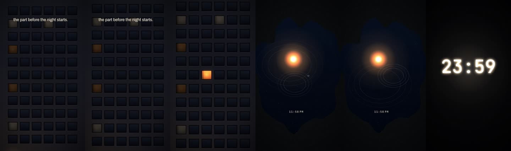

- **Core idea:** The part of the night nobody films: a window switching on, a lamp in a puddle, the clock tipping into midnight, then three shadows heading out on the first sung line.
- **Hook (first second):** "the part before the night starts."
- **Song timestamp:** 0:00.00 - 0:21.50 (bar 1.1 to bar 12.2) · 21.5 s
- **Lyric section:** Intro (0:00-0:15) + 'Moving my feet to the beat of a drum' (0:15.96)
- **Approach:** Quiet setup. Uses the intro the way the record does: keys only, then the first vocal.
- **Clip IDs:** S100, S106, S088, S069
- **Shot order:**
  - 0.00s (0:00.00) **S100** Facade, one window · 7.5s · in: cut
  - 7.50s (0:07.50) **S106** Lamp in a puddle · 3.75s · in: dip
  - 11.25s (0:11.25) **S088** Clock: 23:59 · 4.69s · in: cut
  - 15.94s (0:15.94) **S069** Three shadows walking · 5.56s · in: lampwipe
- **Editing style:** Long holds (3.75-7.5 s), one cut per 2-4 bars, slow push-ins. Nothing reacts until the first vocal.
- **Text:** hook "the part before the night starts." @0:00.00 · label "11:58 PM" @0:07.50 · lyric "Moving my feet to the beat of a drum" @0:15.96
- **Transitions:** Dip on the window, lamp-wipe into the shadows on the first vocal.
- **Payoff:** The clock flips to 00:00 exactly when the percussion enters (0:15.00) and the walk starts on the first word.
- **Loop:** No, it ends walking out of frame (fade).
- **Caption:** the best nights start with nobody saying where we're going.
- **Why it's in the campaign:** First post. Sets the world (sodium, moon, shadows instead of faces) before anyone knows it's a song campaign.

### 2. THE MOON FOLLOWS  `R02-the-moon-follows`

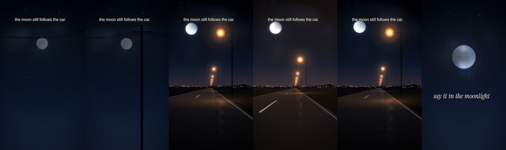

- **Core idea:** Everything on the road rushes past: poles, wires, lamps. The moon doesn't move. It's the one witness to the night, the place you promise to tell the truth.
- **Hook (first second):** "the moon still follows the car."
- **Song timestamp:** 0:29.07 - 0:37.50 (bar 16.3 to bar 21.1) · 8.43 s
- **Lyric section:** 'If I took it alive, I promise to say it in the moonlight' (0:29.31-0:34.76) + breath
- **Approach:** Visual loop built on a childhood observation; the kick entry at 0:30.00 starts the lamps.
- **Clip IDs:** S034, S012, S032
- **Shot order:**
  - 0.00s (0:29.06) **S034** The moon follows (wires) · 0.94s · in: cut
  - 0.93s (0:30.00) **S012** Big moon over the road · 3.75s · in: cut
  - 4.68s (0:33.75) **S032** The moon, clouds crossing · 2.34s · in: cut
  - 7.03s (0:36.09) **S034** The moon follows (wires) · 1.41s · in: cut
- **Editing style:** 4 shots in 8.4 s. Lamps and poles pass exactly on the kick (travel rate locked to the grid). The moon shot has no reactivity at all.
- **Text:** hook "the moon still follows the car." @0:29.06 · lyric "If I took it alive, I promise to say it in the moonlight" @0:33.00
- **Transitions:** Hard cut on the kick entry (0:30.00), cut on the beat before 'moonlight' (0:33.75).
- **Payoff:** 'say it in the moonlight' lands on the only still image in the Reel.
- **Loop:** Yes. Starts and ends on the same wires-and-moon shot, so the loop reads as one endless drive.
- **Caption:** everything on the road moves. except the moon.
- **Why it's in the campaign:** Introduces the central visual idea (everything passes, the moon stays) in under 9 seconds.

### 3. THE SECOND ROLL  `R03-the-second-roll`

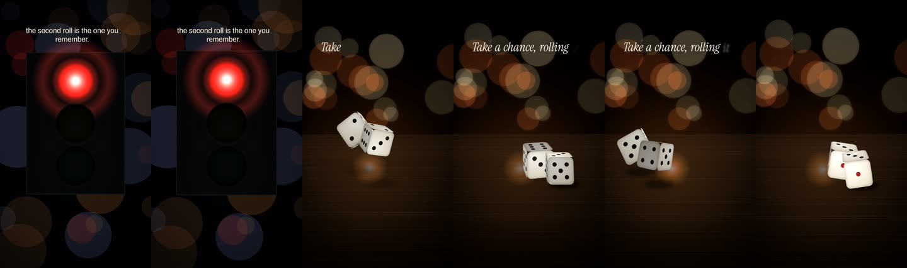

- **Core idea:** Decision, action, consequence. A red light that won't change, two dice thrown on the bar on 'take a chance', thrown again on 'rolling it twice', then a walk signal counting down one beat at a time.
- **Hook (first second):** "the second roll is the one you remember."
- **Song timestamp:** 0:46.40 - 0:56.72 (bar 25.3 to bar 31.2) · 10.32 s
- **Lyric section:** 'Out of sight, out of mind / Take a chance, rolling it twice / It's out of sight...' (0:46.6-0:55.4)
- **Approach:** Tease. Builds the whole pre-chorus and cuts out one beat after the light turns green, before the drop.
- **Clip IDs:** S081, S082, S077
- **Shot order:**
  - 0.01s (0:46.41) **S081** Red, dry night · 2.34s · in: cut
  - 2.35s (0:48.75) **S082** Dice, rolled twice · 3.75s · in: cut
  - 6.10s (0:52.50) **S077** Walk signal countdown · 4.22s · in: cut
- **Editing style:** Cuts on the lyric: dice thrown on 'take a chance' (bar 27) and again exactly where the kick drops out (bar 28). The countdown digits tick on the 8th-roll beats: 8 beats, 8 numbers.
- **Text:** hook "the second roll is the one you remember." @0:46.41 · lyric "Take a chance, rolling it twice" @0:48.73
- **Transitions:** Hard cuts only. Matte tightens through the build.
- **Payoff:** Green light on 0:56.25 as the 16th roll starts, then black. No drop.
- **Loop:** No. Deliberate cliffhanger.
- **Caption:** we never left on the first try.
- **Why it's in the campaign:** Owns the 'take a chance, rolling it twice' line as an image (dice) without spending the drop.

### 4. OUT OF SIGHT  `R04-out-of-sight`

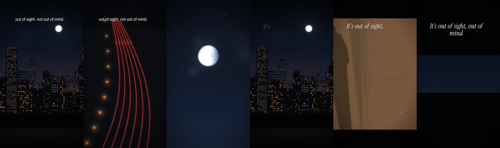

- **Core idea:** 'Out of sight, out of mind' as a visual rule: everything that leaves the frame stops existing. A train slides off the bridge, taillights leave, the moon goes behind cloud, the city switches off window by window, one shadow walks out of the lamp, and the frame closes to a slit.
- **Hook (first second):** "out of sight. not out of mind."
- **Song timestamp:** 2:30.00 - 2:41.25 (bar 81.1 to bar 87.1) · 11.25 s
- **Lyric section:** Build 2: 'Out of sight, out of mind / Take a chance... / It's out of sight, out of mind' (2:31.6-2:40.8)
- **Approach:** Metaphor + tease. Second build, cut to black before the 16th roll.
- **Clip IDs:** S028, S097, S039, S025, S071, S033
- **Shot order:**
  - 0.00s (2:30.00) **S028** Train on the bridge · 1.88s · in: cut
  - 1.88s (2:31.88) **S097** Leaving (all red) · 1.88s · in: cut
  - 3.75s (2:33.75) **S039** Moon, heavy cloud · 1.88s · in: cut
  - 5.63s (2:35.63) **S025** City closing · 1.88s · in: cut
  - 7.50s (2:37.50) **S071** One shadow · 1.88s · in: cut
  - 9.38s (2:39.38) **S033** Small high moon · 1.88s · in: cut
- **Editing style:** One shot per bar, every shot ends with something leaving. From the kick-out (2:35.63) windows go dark on each beat.
- **Text:** hook "out of sight. not out of mind." @2:30.00 · lyric "It's out of sight, out of mind" @2:36.50
- **Transitions:** Matte closes from full frame to a slit over the last two bars; final cut to black on 2:41.25.
- **Payoff:** Black, with the 16th roll just starting. The viewer has to go find the drop.
- **Loop:** No.
- **Caption:** some things you leave behind on purpose.
- **Why it's in the campaign:** Second tease, uses build 2 so build 1 stays fresh for the vocal-to-drop Reels.

---

## Phase B - Recognition

### 5. NO DESTINATION  `R05-no-destination`

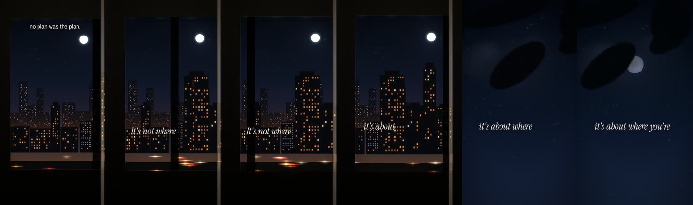

- **Core idea:** A ride with no stated end: train window, trees whipping past the moon, a friend's taillights ahead. The line does the talking. The kick arrives under 'alive' and we're suddenly on the open road.
- **Hook (first second):** "no plan was the plan."
- **Song timestamp:** 0:22.50 - 0:30.94 (bar 13.1 to bar 17.3) · 8.44 s
- **Lyric section:** 'It's not where you been, it's about where you're goin' (0:23.41-0:28.64) + 'If I took it alive' pickup
- **Approach:** Lyric-led, verse 1. Ends one beat into the kick entry as a tease of the groove.
- **Clip IDs:** S018, S035, S005, S001
- **Shot order:**
  - 0.00s (0:22.50) **S018** Train window, city and moon · 3.75s · in: cut
  - 3.75s (0:26.25) **S035** The moon follows (trees) · 1.88s · in: cut
  - 5.63s (0:28.13) **S005** Following their taillights · 1.88s · in: cut
  - 7.50s (0:30.00) **S001** The drive, moon on the left · 0.94s · in: cut
- **Editing style:** Cuts on 2-bar phrases; masts and branches pass at the verse travel rate (2 per bar), so motion speeds up the moment the kick comes in.
- **Text:** hook "no plan was the plan." @0:22.50 · lyric "It's not where you been, it's about where you're goin" @0:23.41 · lyric "It's not where you been, it's about where you're goin" @0:25.07
- **Transitions:** Cut, cut, hard cut on 0:30.00.
- **Payoff:** The road and its lamps start pumping on the kick entry.
- **Loop:** Loosely: ends moving forward, starts moving forward.
- **Caption:** it's not where you been.
- **Why it's in the campaign:** Makes the most quotable verse line recognisable on its own.

### 6. 3AM HONESTY  `R06-3am-honesty`

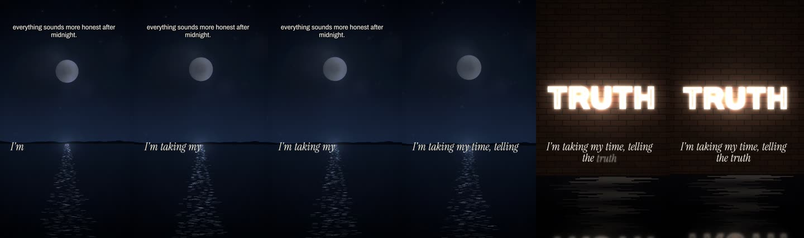

- **Core idea:** The truth lines, set against the calmest images in the library: moonlight on black water, a buzzing neon word, the moon in a puddle that ripples on each kick, a cold white road.
- **Hook (first second):** "everything sounds more honest after midnight."
- **Song timestamp:** 0:36.57 - 0:46.41 (bar 20.3 to bar 25.4) · 9.84 s
- **Lyric section:** 'I'm taking my time, telling the truth / 'Cause only fools lie, fools lie' (0:37.06-0:46.2)
- **Approach:** Lyric-focused, intimate. The C-minor side of the song.
- **Clip IDs:** S037, S065, S104, S009
- **Shot order:**
  - 0.00s (0:36.56) **S037** Moon on black water · 4.69s · in: cut
  - 4.68s (0:41.25) **S065** Neon: TRUTH · 1.41s · in: fade
  - 6.09s (0:42.66) **S104** Moon in a puddle · 1.88s · in: cut
  - 7.96s (0:44.53) **S009** Cold LED road · 1.88s · in: cut
- **Editing style:** Long first shot (4.7 s). The TRUTH sign buzzes on the line. Puddle rings land on the verse kicks.
- **Text:** hook "everything sounds more honest after midnight." @0:36.56 · lyric "I'm taking my time, telling the truth" @0:37.06 · lyric "'Cause only fools lie, fools lie" @0:42.80
- **Transitions:** Fade into TRUTH, cuts after.
- **Payoff:** 'fools lie' over the cold road: the warm palette drops away.
- **Loop:** No.
- **Caption:** only fools lie.
- **Why it's in the campaign:** Gives the song an emotional voice, not just a drop.

### 7. THE WALK HOME  `R07-the-walk-home`

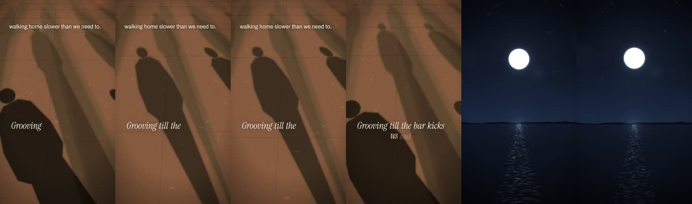

- **Core idea:** Everyone spills out, the night goes quiet, and for two seconds there's no music under anything. Then the kick comes back.
- **Hook (first second):** "walking home slower than we need to."
- **Song timestamp:** 1:50.10 - 2:00.47 (bar 59.3 to bar 65.2) · 10.37 s
- **Lyric section:** Breakdown: 'Grooving till the bar kicks us out / Oh, oh, oh' (1:50.7-1:58.9) + near silence + kick return (2:00.00)
- **Approach:** Quiet → payoff. The breakdown is the most intimate part of the record; this Reel lives inside it.
- **Clip IDs:** S072, S037, S108, S007
- **Shot order:**
  - 0.01s (1:50.11) **S072** A crowd of shadows · 5.09s · in: cut
  - 5.10s (1:55.20) **S037** Moon on black water · 2.92s · in: fade
  - 8.03s (1:58.13) **S108** Still puddle · 1.88s · in: cut · time warp x0
  - 9.90s (2:00.00) **S007** Open road, no lamps · 0.47s · in: cut
- **Editing style:** Three slow shots, then a held, totally still puddle in the near-silence (1:58.1-2:00), then the open road on the returning kick.
- **Text:** hook "walking home slower than we need to." @1:50.16 · lyric "Grooving till the bar kicks us out" @1:50.67
- **Transitions:** Fades between the slow shots, matte closes in the silence and snaps open on the kick.
- **Payoff:** The kick at 2:00.00 opens the frame and the road starts moving.
- **Loop:** No.
- **Caption:** nobody said it but nobody wanted to go home yet.
- **Why it's in the campaign:** Recognition through feeling: the breakdown vocal is the most human moment in the track.

### 8. WE RISE AND WE FALL  `R08-we-rise-and-we-fall`

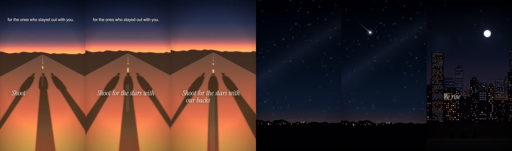

- **Core idea:** The bridge lyric, sung once in the whole song, gets the most cinematic treatment: our three shadows running ahead with the sun behind us, a shooting star across the 2-second gap after 'sun', the rooftop, the lyric becoming a neon sign, then just stars.
- **Hook (first second):** "for the ones who stayed out with you."
- **Song timestamp:** 2:00.00 - 2:15.00 (bar 65.1 to bar 73.1) · 15 s
- **Lyric section:** 'Shoot for the stars with our backs to the sun / We rise and we fall, living forever young' (2:00.79-2:14.03)
- **Approach:** Lyric-focused emotional peak. Longest takes in the campaign.
- **Clip IDs:** S046, S043, S024, S066, S040
- **Shot order:**
  - 0.00s (2:00.00) **S046** Backs to the sun (three) · 5.63s · in: cut
  - 5.63s (2:05.63) **S043** Shooting star · 1.88s · in: fade
  - 7.50s (2:07.50) **S024** Rooftop, three of us · 3.75s · in: cut
  - 11.25s (2:11.25) **S066** Neon: forever young · 1.88s · in: cut
  - 13.13s (2:13.13) **S040** Star field · 1.88s · in: cut
- **Editing style:** 5.6 s opening take. The shooting star is placed in the vocal gap (2:05.7-2:08.0) so the silence has an event. The camera rises on 'we rise'.
- **Text:** hook "for the ones who stayed out with you." @2:00.00 · lyric "Shoot for the stars with our backs to the sun" @2:00.79 · lyric "We rise and we fall, living forever young" @2:07.99
- **Transitions:** Fade into the stars, cut on 'we rise', cut into the neon on 'forever young'.
- **Payoff:** 'forever young' appears as a sign in the world instead of a caption.
- **Loop:** No, ends on open sky.
- **Caption:** we rise and we fall. say it while it's still true.
- **Why it's in the campaign:** This is the line people will quote. It should feel like a memory, not an ad.

---

## Phase C - Song identity

### 9. WRITTEN ON THE ROAD  `R09-written-on-the-road`

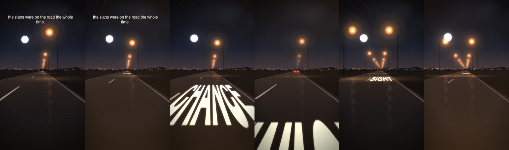

- **Core idea:** The pre-chorus is painted on the asphalt, each word arriving under the car as it's sung. The build becomes a tunnel; 'kicks us OUT' bursts out of it and the word OUT passes under the wheels on the drop.
- **Hook (first second):** "the signs were on the road the whole time."
- **Song timestamp:** 0:45.00 - 1:03.75 (bar 25.1 to bar 35.1) · 18.75 s
- **Lyric section:** Build 1 + drop 1: 'Out of sight... take a chance, rolling it twice... moving to the music, grooving till the bar kicks us OUT' (0:46.6-1:01.4)
- **Approach:** Vocal-to-drop. The words are the environment, not captions.
- **Clip IDs:** S001, S010, S011, S013
- **Shot order:**
  - 0.00s (0:45.00) **S001** The drive, moon on the left · 5.63s · in: cut
  - 5.63s (0:50.63) **S010** Fog drive · 1.88s · in: cut
  - 7.50s (0:52.50) **S011** MOVING / TO THE / MUSIC painted · 3.75s · in: lampwipe
  - 11.25s (0:56.25) **S013** Tunnel, exit on the drop · 3.75s · in: cut
  - 15.00s (1:00.00) **S011** MOVING / TO THE / MUSIC painted · 3.75s · in: cut
- **Editing style:** Road words timed to the vocal (SIGHT, MIND, CHANCE, TWICE, SIGHT, MIND). Kick drops out at 0:50.63 and the road goes to fog. 8th roll: lamps double. 16th roll: tunnel. Drop: exit flash, lamp on every kick, small punch on each one.
- **Text:** hook "the signs were on the road the whole time." @0:45.00 · lyric "Moving to the music," @0:55.97 · lyric "grooving till the bar kicks us out" @0:57.92
- **Transitions:** Cut into fog on the kick-out, lamp-wipe into the 8ths, tunnel exit flash on 1:00.000.
- **Payoff:** OUT painted on the road passes under the camera in the first beat of the drop.
- **Loop:** No.
- **Caption:** out of sight, out of mind. it was written on the road the whole way.
- **Why it's in the campaign:** The clearest statement of what the song is: movement, risk, the hook line and the drop in one shot language.

### 10. 1:59  `R10-1-59`

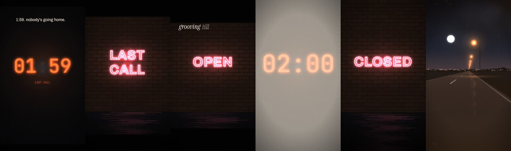

- **Core idea:** Closing time as a countdown. The clock sits on 01:59 through the build, LAST CALL buzzes, the sign still says OPEN... and the minute flips to 02:00 on the drop. The bar kicks us out, literally on 'out', and we're on the road.
- **Hook (first second):** "1:59. nobody's going home."
- **Song timestamp:** 0:52.50 - 1:03.75 (bar 29.1 to bar 35.1) · 11.25 s
- **Lyric section:** 8th/16th build + 'grooving till the bar kicks us out' → drop 1 (0:52.5-1:03.75)
- **Approach:** Vocal-to-drop story. The drop is a time, not an effect.
- **Clip IDs:** S089, S061, S062, S086, S001
- **Shot order:**
  - 0.00s (0:52.50) **S089** Clock: LAST CALL · 3.75s · in: cut
  - 3.75s (0:56.25) **S061** Neon: LAST CALL · 1.88s · in: cut
  - 5.63s (0:58.13) **S062** Neon: OPEN -> CLOSED · 1.41s · in: cut
  - 7.03s (0:59.53) **S086** Clock: 02:00 on the drop · 0.94s · in: cut
  - 7.97s (1:00.47) **S062** Neon: OPEN -> CLOSED · 0.47s · in: cut
  - 8.44s (1:00.94) **S001** The drive, moon on the left · 2.81s · in: cut
- **Editing style:** Cuts accelerate with the roll: 3.75 s, 1.9 s, 0.94 s, then one-beat shots across the drop (clock flip, CLOSED, road).
- **Text:** hook "1:59. nobody's going home." @0:52.50 · lyric "grooving till the bar kicks us out" @0:57.92
- **Transitions:** Matte closes during the build; exposure flash on the flip.
- **Payoff:** 01:59 → 02:00 exactly on 1:00.000, then the road with a lamp on every kick.
- **Loop:** No, ends hard on the bar line.
- **Caption:** closing time was never the end of it.
- **Why it's in the campaign:** Gives the drop a story the audience remembers ('the 2am song').

### 11. WHEN THE LIGHTS COME ON  `R11-when-the-lights-come-on`

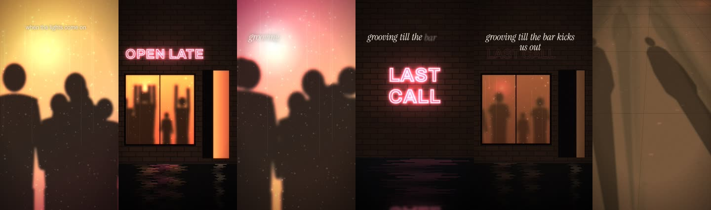

- **Core idea:** Inside the drop we only ever see the party through steamed glass. On the last kick of drop 1 (1:45.00) the neon dies and the lights go out in steps, one per beat. Then it's just our shadows on the pavement and the 'oh, oh'.
- **Hook (first second):** "when the lights come on."
- **Song timestamp:** 1:37.50 - 1:50.63 (bar 53.1 to bar 60.1) · 13.13 s
- **Lyric section:** End of drop 1 + 'grooving till the bar kicks us out / Oh, oh' (1:40.9-1:50.5)
- **Approach:** Story: nightlife → kicked out → walking. The end of drop 1 into the breakdown.
- **Clip IDs:** S057, S051, S059, S061, S052, S069
- **Shot order:**
  - 0.00s (1:37.50) **S057** Frosted glass, warm · 3.75s · in: cut
  - 3.75s (1:41.25) **S051** Bar, open late · 1.88s · in: cut
  - 5.63s (1:43.13) **S059** Frosted crowd · 0.94s · in: cut
  - 6.56s (1:44.06) **S061** Neon: LAST CALL · 0.94s · in: cut
  - 7.50s (1:45.00) **S052** Bar, last call · 1.88s · in: cut
  - 9.38s (1:46.88) **S069** Three shadows walking · 3.75s · in: lampwipe
- **Editing style:** Groove cuts in the drop (2 bars, then 1 bar), the closing plays as one take so you watch the lights go beat by beat, then a slow walk.
- **Text:** hook "when the lights come on." @1:37.50 · lyric "grooving till the bar kicks us out" @1:42.94
- **Transitions:** Cuts in the drop, hard cut on 1:45.000, lamp-wipe into the walk.
- **Payoff:** The sign stutters out on the exact frame the kick stops.
- **Loop:** No, fades out walking.
- **Caption:** the bar kicked us out. the night didn't.
- **Why it's in the campaign:** Makes the lyric's image (the bar kicking us out) the brand story of the song.

---

## Phase D - Strongest musical moments

### 12. THE CITY PLAYS ALONG  `R12-the-city-plays-along`

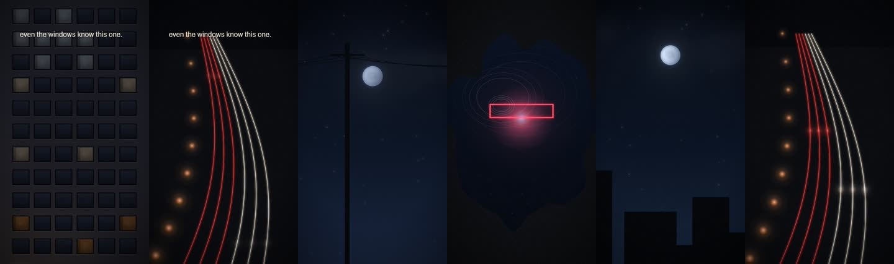

- **Core idea:** Rhythm-driven. The city performs the drop: apartment windows play the real kick/clap/hat pattern, beacons blink on the kick, light pulses ride the highway lanes, bodies bounce behind glass.
- **Hook (first second):** "even the windows know this one."
- **Song timestamp:** 1:07.50 - 1:22.50 (bar 37.1 to bar 45.1) · 15 s
- **Lyric section:** Drop 1, bars 37-44 (1:07.5-1:22.5), vocal chops at 1:07.7 and 1:09.2
- **Approach:** Rhythm-driven drop edit, cut on claps (beats 2 and 4) and phrase lines, never on every beat.
- **Clip IDs:** S101, S027, S095, S057, S034, S023, S105, S102, S036
- **Shot order:**
  - 0.00s (1:07.50) **S101** Facade as a sequencer · 0.94s · in: cut
  - 0.94s (1:08.44) **S027** City breathing with the bass · 0.94s · in: cut
  - 1.88s (1:09.38) **S095** Light trails, curve · 1.88s · in: cut
  - 3.75s (1:11.25) **S057** Frosted glass, warm · 1.88s · in: cut
  - 5.63s (1:13.13) **S034** The moon follows (wires) · 1.88s · in: cut
  - 7.50s (1:15.00) **S023** City stream, no frame · 1.88s · in: cut
  - 9.38s (1:16.88) **S105** Neon in a puddle · 0.94s · in: cut
  - 10.31s (1:17.81) **S102** Facade, one flat partying · 0.94s · in: cut
  - 11.25s (1:18.75) **S036** The moon follows (rooftops) · 1.88s · in: cut
  - 13.13s (1:20.63) **S101** Facade as a sequencer · 0.47s · in: cut
  - 13.59s (1:21.09) **S095** Light trails, curve · 0.47s · in: cut
  - 14.06s (1:21.56) **S027** City breathing with the bass · 0.47s · in: cut
  - 14.53s (1:22.03) **S057** Frosted glass, warm · 0.47s · in: cut
- **Editing style:** Phrase 1: two 2-beat cuts, then 1-bar shots; the heavy Cm bar (bar 39) gets the longest, deepest-pushing shot. Phrase 2 mirrors it, and the last bar accelerates to one shot per beat as a fill into the loop point.
- **Text:** hook "even the windows know this one." @1:07.50
- **Transitions:** Hard cuts only, on claps and bar lines.
- **Payoff:** Bar 44: four one-beat shots, then it loops back to the windows.
- **Loop:** Yes, bar 37 to bar 45 is 8 full bars of the same loop; the audio and the first shot line up.
- **Caption:** the whole city's on the same beat tonight.
- **Why it's in the campaign:** Shows the groove itself; no lyric needed, high replay value.

### 13. BEHIND THE GLASS  `R13-behind-the-glass`

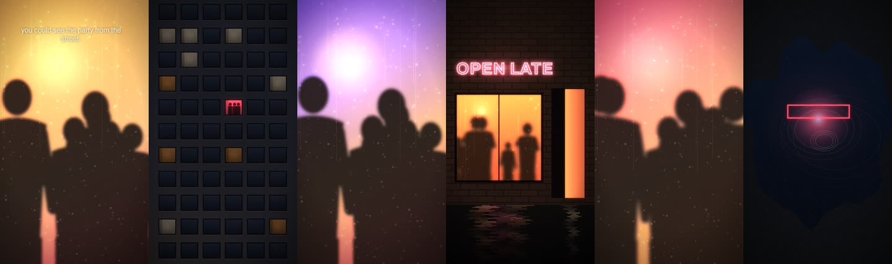

- **Core idea:** Dancing without faces. We stay on the street side of the window: shapes behind steamed glass bounce on the kick and throw their arms up on the heavy bass bar, a single flat in a dark block is the only party in town.
- **Hook (first second):** "you could see the party from the street."
- **Song timestamp:** 1:22.50 - 1:37.50 (bar 45.1 to bar 53.1) · 15 s
- **Lyric section:** Drop 1, bars 45-52 (1:22.5-1:37.5), vocal chops 1:24.6 and 1:28.0-1:31.3
- **Approach:** Groove-follow. Longer shots that let the dancing play; the bass bars decide where the cuts go.
- **Clip IDs:** S057, S102, S058, S051, S059, S105
- **Shot order:**
  - 0.00s (1:22.50) **S057** Frosted glass, warm · 3.75s · in: cut
  - 3.75s (1:26.25) **S102** Facade, one flat partying · 1.88s · in: cut
  - 5.63s (1:28.13) **S058** Frosted glass, rose · 1.88s · in: cut
  - 7.50s (1:30.00) **S051** Bar, open late · 1.88s · in: cut
  - 9.38s (1:31.88) **S059** Frosted crowd · 3.75s · in: cut
  - 13.13s (1:35.63) **S105** Neon in a puddle · 0.94s · in: cut
  - 14.06s (1:36.56) **S057** Frosted glass, warm · 0.94s · in: fade
- **Editing style:** 2-bar opening take, cuts on bar lines, the bass-accent bars (47, 51) get the shots with arms up and the deepest camera push.
- **Text:** hook "you could see the party from the street." @1:22.50
- **Transitions:** Cuts; one fade between the two frosted shots.
- **Payoff:** Bar 51: the crowd shot with every arm up on the heaviest bass of the phrase.
- **Loop:** Yes, 8 bars from a phrase start.
- **Caption:** we were the window you could see from the street.
- **Why it's in the campaign:** The nightlife/dance pillar without stock dancers or DJ hands.

### 14. EXIT  `R14-exit`

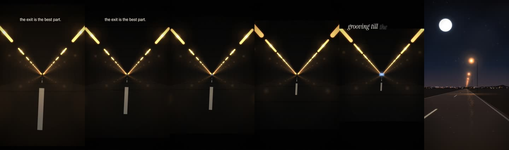

- **Core idea:** Impact-driven. One tunnel, one exit. The fixtures accelerate with the 8th and 16th rolls, the frame tightens, and the opening at the end grows until we burst out into the night on the drop.
- **Hook (first second):** "the exit is the best part."
- **Song timestamp:** 2:37.50 - 2:48.75 (bar 85.1 to bar 91.1) · 11.25 s
- **Lyric section:** Build 2 into drop 2: 'moving to the music, grooving till the bar kicks us out' (2:40.96-2:45.85)
- **Approach:** Build-and-release with as few cuts as possible: the drop is the only cut that matters.
- **Clip IDs:** S013, S012
- **Shot order:**
  - 0.00s (2:37.50) **S013** Tunnel, exit on the drop · 7.5s · in: cut
  - 7.50s (2:45.00) **S012** Big moon over the road · 3.75s · in: cut
- **Editing style:** A 7.5 s single take through the build, then one 3.75 s shot of the drop. The only reactive moves are tension (zoom creep) in the build and a single big push on the drop.
- **Text:** hook "the exit is the best part." @2:37.50 · lyric "grooving till the bar kicks us out" @2:42.95
- **Transitions:** Matte closes through the build and snaps open with an exposure flash on 2:45.000.
- **Payoff:** Burst out of the tunnel exactly on 'OUT'.
- **Loop:** No.
- **Caption:** some nights you hear the exit before you see it.
  - some nights you hear the exit before you see it.
  - 2:45. that's where it opens up.
  - the tunnel was the build. the exit was the drop.
  - moonlight · AMISHAR  #progressivehouse #melodichouse #latenight #AMISHAR
- **Why it's in the campaign:** The cleanest possible drop moment for the strongest drop.

### 15. STILL  `R15-still`

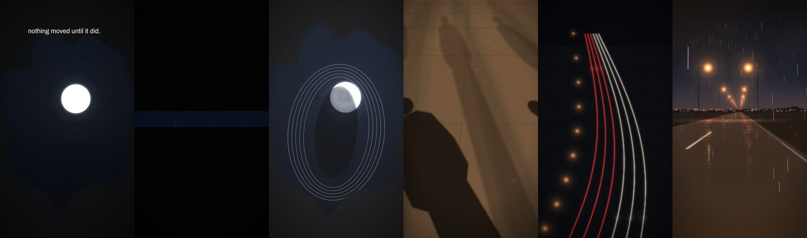

- **Core idea:** Contrast. Drop 2 is playing at full power and the picture refuses to move: a still puddle holding the moon, no camera, no reaction. When the kick drops out (3:13.1) the frame closes to a slit. When it slams back (3:15.000) a foot lands in the moon and everything moves at once.
- **Hook (first second):** "nothing moved until it did."
- **Song timestamp:** 3:07.50 - 3:18.75 (bar 101.1 to bar 107.1) · 11.25 s
- **Lyric section:** Drop 2, bars 101-106 (3:07.5-3:18.75), kick-out bar 104
- **Approach:** Extremely restrained opening → sudden reaction, built on the kick-out bar that only exists in drop 2.
- **Clip IDs:** S108, S033, S107, S070, S095, S002
- **Shot order:**
  - 0.00s (3:07.50) **S108** Still puddle · 5.63s · in: cut · time warp x0
  - 5.63s (3:13.13) **S033** Small high moon · 1.88s · in: cut
  - 7.50s (3:15.00) **S107** Footstep in the puddle · 0.47s · in: cut
  - 7.97s (3:15.47) **S070** Shadows running · 1.41s · in: cut
  - 9.38s (3:16.88) **S095** Light trails, curve · 0.94s · in: cut
  - 10.31s (3:17.81) **S002** Rain on the road · 0.94s · in: cut
- **Editing style:** 5.6 s frozen frame, 1 bar of slit, then four fast shots (one beat, then 1-2 bars) in the slam.
- **Text:** hook "nothing moved until it did." @3:07.50
- **Transitions:** Matte to slit in the kick-out bar, flash + full open on the slam.
- **Payoff:** The moon reflection shatters on 3:15.000.
- **Loop:** No.
- **Caption:** wait for it.
- **Why it's in the campaign:** Different from every other drop Reel because the visuals ignore the music on purpose until the one moment they can't.

### 16. THE SUMMER NOBODY SLEPT  `R16-the-summer-nobody-slept`

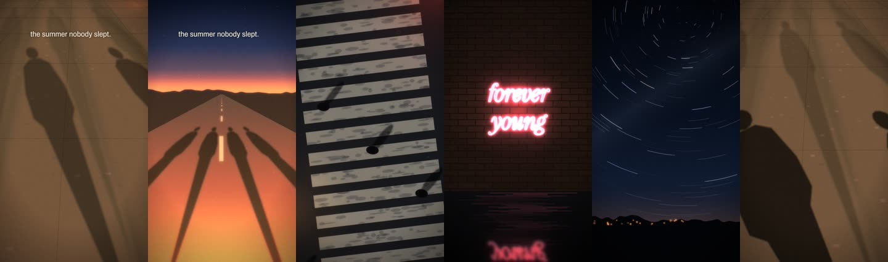

- **Core idea:** A youth montage without models or fake freedom: running shadows, four shadows racing the sun, the rooftop, a crowd on the crossing, glass full of dancers, 'forever young' as a neon sign, star trails, the open road.
- **Hook (first second):** "the summer nobody slept."
- **Song timestamp:** 2:52.50 - 3:07.50 (bar 93.1 to bar 101.1) · 15 s
- **Lyric section:** Drop 2, bars 93-100 (2:52.5-3:07.5)
- **Approach:** Phrase montage: one image per bar, faster only at the end of the 8-bar phrase.
- **Clip IDs:** S070, S050, S024, S076, S058, S066, S041, S007, S095
- **Shot order:**
  - 0.00s (2:52.50) **S070** Shadows running · 1.88s · in: cut
  - 1.88s (2:54.38) **S050** Running into it · 1.88s · in: cut
  - 3.75s (2:56.25) **S024** Rooftop, three of us · 1.88s · in: cut
  - 5.63s (2:58.13) **S076** Crosswalk crowd · 1.88s · in: cut
  - 7.50s (3:00.00) **S058** Frosted glass, rose · 1.88s · in: cut
  - 9.38s (3:01.88) **S066** Neon: forever young · 1.88s · in: cut
  - 11.25s (3:03.75) **S041** Star trails · 1.88s · in: cut
  - 13.13s (3:05.63) **S007** Open road, no lamps · 0.94s · in: cut
  - 14.06s (3:06.56) **S070** Shadows running · 0.47s · in: cut
  - 14.53s (3:07.03) **S095** Light trails, curve · 0.47s · in: cut
- **Editing style:** Bar-length shots; the heavy Cm bars (95, 99) hold the two widest, most emotional images (rooftop, star trails) with the deepest push; bar 100 splits into beats as a fill.
- **Text:** hook "the summer nobody slept." @2:52.50
- **Transitions:** Hard cuts on bar lines.
- **Payoff:** 'forever young' neon on bar 98, star trails on the heaviest bass of the phrase.
- **Loop:** Yes, 8 bars of the same loop.
- **Caption:** we were young and up all night and it felt like it would last.
- **Why it's in the campaign:** Youth/freedom pillar, built from the library instead of stock 'freedom' footage.

---

## Phase E - Release push

### 17. THE SIGN  `R17-the-sign`

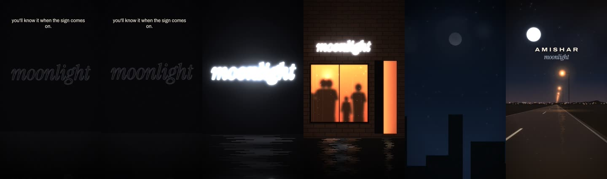

- **Core idea:** A dead neon tube that says 'moonlight' hangs in the dark through the roll. It stutters on exactly on the drop. Then the bar it belongs to, the city, and the name.
- **Hook (first second):** "you'll know it when the sign comes on."
- **Song timestamp:** 2:41.27 - 2:52.50 (bar 87.1 to bar 93.1) · 11.23 s
- **Lyric section:** 16th roll + 'grooving till the bar kicks us out' → drop 2 (2:41.25-2:52.5)
- **Approach:** Title reveal on the strongest drop. The only Reel that spells out artist + title on screen.
- **Clip IDs:** S064, S054, S036, S012
- **Shot order:**
  - 0.00s (2:41.25) **S064** Neon: moonlight · 5.63s · in: cut
  - 5.61s (2:46.88) **S054** Bar, serif sign · 1.88s · in: cut
  - 7.48s (2:48.75) **S036** The moon follows (rooftops) · 1.88s · in: cut
  - 9.36s (2:50.63) **S012** Big moon over the road · 1.88s · in: cut
- **Editing style:** 3.75 s hold on the unlit sign, flicker-on synced to 2:45.000, then 1-bar shots with groove reactivity, title lockup over the last bar.
- **Text:** hook "you'll know it when the sign comes on." @2:41.25 · title "" @2:50.63
- **Transitions:** Flash on the drop, hard cuts after.
- **Payoff:** The title literally lights up on the drop.
- **Loop:** No, ends on the lockup.
- **Caption:** moonlight. AMISHAR.
- **Why it's in the campaign:** Release day: the name and the feeling arrive in the same frame.

### 18. NINE SECONDS WITHOUT A KICK  `R18-nine-seconds-without-a-kick`

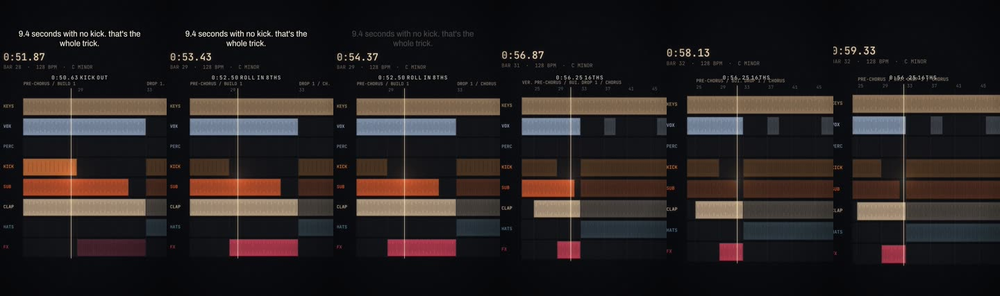

- **Core idea:** Micro-detail for people who make music. A stylised arrangement of the actual track shows the kick lane stopping at 0:50.63 and the roll going 8ths then 16ths; at 1:00.000 the drop's real step pattern plays, then the city's windows play it.
- **Hook (first second):** "9.4 seconds with no kick. that's the whole trick."
- **Song timestamp:** 0:50.63 - 1:05.63 (bar 28.1 to bar 36.1) · 14.99 s
- **Lyric section:** Build 1 into drop 1 (0:50.63-1:05.63)
- **Approach:** Micro-detail / production, built from the measured arrangement, not a DAW screen recording.
- **Clip IDs:** S110, S109, S112, S101
- **Shot order:**
  - 0.00s (0:50.63) **S110** Arrangement, zoomed on the drop · 5.63s · in: cut
  - 5.62s (0:56.25) **S109** Arrangement, following · 3.75s · in: cut
  - 9.37s (1:00.00) **S112** Drop step grid · 1.88s · in: cut
  - 11.24s (1:01.88) **S101** Facade as a sequencer · 3.75s · in: cut
- **Editing style:** The arrangement scrolls with the audio; mono labels mark each real event at its timestamp; cut to the step grid on the drop, then the facade sequencer.
- **Text:** hook "9.4 seconds with no kick. that's the whole trick." @0:50.63 · label "0:50.63  kick out" @0:50.63 · label "0:52.50  roll in 8ths" @0:52.50 · label "0:56.25  16ths" @0:56.25 · label "1:00.000" @1:00.00
- **Transitions:** Hard cuts on bar 31 and the drop.
- **Payoff:** The step grid lights up on 1:00.000.
- **Loop:** No.
- **Caption:** take the floor away before you drop the floor.
- **Why it's in the campaign:** Credibility with producers and DJs during release week; a different kind of shareable.

### 19. THE LONG WAY HOME  `R19-the-long-way-home`

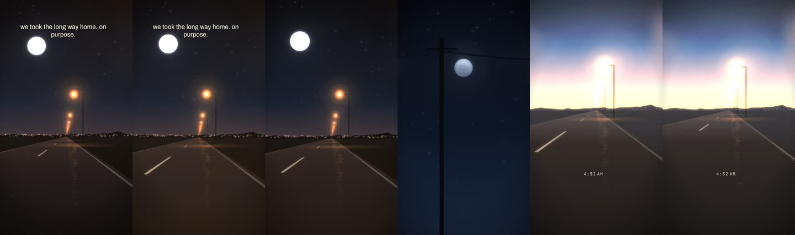

- **Core idea:** The cinematic one. A long drive under the moon through the end of drop 2, a float through the last kick-out, then the final hit becomes morning: lamps switching off one by one, the sun behind the city, the name.
- **Hook (first second):** "we took the long way home. on purpose."
- **Song timestamp:** 3:22.50 - 3:45.00 (bar 109.1 to bar 121.1) · 22.5 s
- **Lyric section:** End of drop 2 + final vocal (3:26.2) + outro (3:30-3:45)
- **Approach:** Cinematic: long takes, rare and precise reactions (the last kick-out floats, the last hit turns the night into morning).
- **Clip IDs:** S012, S034, S008, S049
- **Shot order:**
  - 0.00s (3:22.50) **S012** Big moon over the road · 5.63s · in: cut
  - 5.63s (3:28.13) **S034** The moon follows (wires) · 1.88s · in: cut
  - 7.50s (3:30.00) **S008** Lamps switch off at dawn · 7.5s · in: cut
  - 15.00s (3:37.50) **S049** Sunrise behind the city · 7.5s · in: fade
- **Editing style:** 7.5 s opening take with only a light kick response; no punch during the kick-out bar; the outro is three long shots and the title.
- **Text:** hook "we took the long way home. on purpose." @3:22.50 · label "4:52 AM" @3:30.40 · title "" @3:41.25
- **Transitions:** Soft flash on 3:30.000, fades through the outro.
- **Payoff:** The final hit of the song is the moment the night becomes morning.
- **Loop:** No, ends on the lockup and silence.
- **Caption:** the sky was getting light when we got home.
  - the sky was getting light when we got home. nobody said a word.
  - we took the long way home. on purpose.
  - some nights end. this one just turned into morning.
  - moonlight · AMISHAR  #progressivehouse #melodichouse #latenight #AMISHAR
- **Why it's in the campaign:** Release-week anchor: the whole emotional arc (movement → night → afterglow) in one Reel.

---

## Phase F - Long-tail discovery

### 20. WATCH THE LAMPS  `R20-watch-the-lamps`

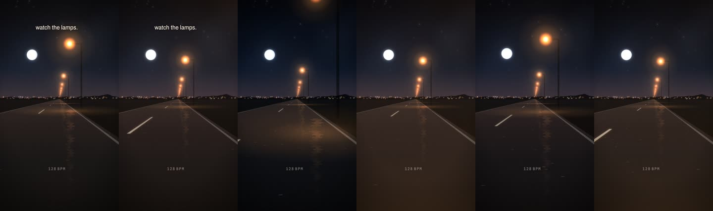

- **Core idea:** One shot. A night drive where a streetlamp passes overhead exactly on every kick. Nothing else.
- **Hook (first second):** "watch the lamps."
- **Song timestamp:** 3:00.00 - 3:07.50 (bar 97.1 to bar 101.1) · 7.5 s
- **Lyric section:** Drop 2, bars 97-100 (3:00.0-3:07.5)
- **Approach:** Satisfying-sync loop for discovery; one take, zero cuts.
- **Clip IDs:** S001
- **Shot order:**
  - 0.00s (3:00.00) **S001** The drive, moon on the left · 7.5s · in: cut
- **Editing style:** No cuts. Kick = lamp pass + 1% punch; heavy Cm bar = slower deeper push.
- **Text:** hook "watch the lamps." @3:00.00 · label "128 BPM" @3:00.00
- **Transitions:** None.
- **Payoff:** You notice the sync on the second loop.
- **Loop:** Perfect: 4 bars of the loop, the last frame flows into the first.
- **Caption:** 128 bpm. one lamp per kick.
- **Why it's in the campaign:** Long-tail: the kind of Reel people rewatch and share without knowing the song yet.

### 21. REWIND  `R21-rewind`

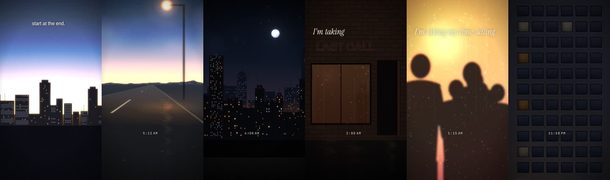

- **Core idea:** Reverse narrative. Start at sunrise and play the night backwards: the sun goes down, the lamps relight, the city's windows come back on, the bar's lights return, the dancers move in reverse, the walk goes backwards, and one window goes dark. The music keeps going forward over it.
- **Hook (first second):** "start at the end."
- **Song timestamp:** 2:14.07 - 2:30.00 (bar 72.3 to bar 81.1) · 15.93 s
- **Lyric section:** Verse 2: 'If I took it alive... in the moonlight / I'm taking my time, telling the truth / 'cause only fools lie' (2:14.1-2:30.0)
- **Approach:** Memory of a night; time runs backwards inside every shot while the song plays forward.
- **Clip IDs:** S049, S008, S025, S052, S057, S100
- **Shot order:**
  - 0.00s (2:14.06) **S049** Sunrise behind the city · 2.34s · in: cut · time warp x-1
  - 2.34s (2:16.41) **S008** Lamps switch off at dawn · 2.81s · in: dip · time warp x-1
  - 5.15s (2:19.22) **S025** City closing · 2.81s · in: dip · time warp x-1
  - 7.96s (2:22.03) **S052** Bar, last call · 2.81s · in: dip · time warp x-1
  - 10.78s (2:24.84) **S057** Frosted glass, warm · 2.81s · in: dip · time warp x-1
  - 13.59s (2:27.66) **S100** Facade, one window · 2.34s · in: dip · time warp x-1
- **Editing style:** Six shots, each a reversed piece of the night, with a mono clock label counting backwards.
- **Text:** hook "start at the end." @2:14.06 · label "5:12 AM" @2:16.61 · label "4:30 AM" @2:19.42 · label "2:00 AM" @2:22.23 · label "1:15 AM" @2:25.04 · label "11:58 PM" @2:27.86 · lyric "I'm taking my time, telling the truth" @2:22.06
- **Transitions:** Dips between chapters.
- **Payoff:** Ends where R01 started: one window, someone getting ready to go out.
- **Loop:** Conceptually loops into R01.
- **Caption:** how did we end up here? start at the end.
- **Why it's in the campaign:** Long-tail: rewards people who have already seen the campaign.
