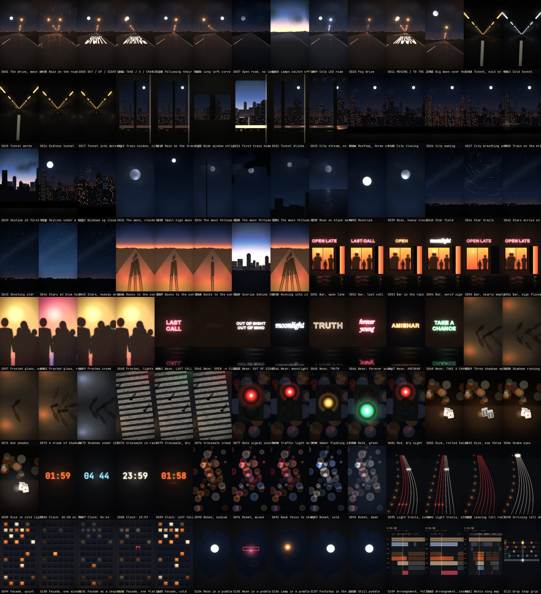

# MOONLIGHT visual board

112 shots, all generated in this repo. No stock footage, no AI imagery, no third-party licences to track: every frame is drawn by the Remotion generators in `src/shots/` and owned by AMISHAR.

## How to use it

- **Browse:** `contact-sheet.jpg`, or the category pages in `categories/` (each shot has a still, what you see, the emotion, lyric and section match, energy, colour and how it reacts to the music).
- **Machine-readable:** `clips.json` (one entry per shot: id, title, category, description, emotional role, lyric match, section match, energy, colour/mood, reel types, music reactivity, parameters, and which Reels use it).
- **Preview a shot moving:** `npm run studio`, then open **Shots / Shot-S0xx**. Change `start` in the props panel to see the same shot at a different point of the song: lamps pass once per bar in the intro and on every kick in the drops.
- **Use a shot in a Reel:** reference its id in a spec, e.g. `{ shot: "S034", from: bar(17), to: bar(19) }`, and override any parameter with `params`.

`clips.json` and `categories/` are generated from `src/library/shots.ts` by `npx tsx scripts/export.ts`. Edit the library, not the JSON.

## Categories

| Category | File | Shots |
|---|---|---|
| Movement / walking / driving | [movement.md](categories/movement.md) | 10 |
| City motion | [city_motion.md](categories/city_motion.md) | 8 |
| Nightlife | [nightlife.md](categories/nightlife.md) | 10 |
| Friends / group energy | [friends.md](categories/friends.md) | 4 |
| Dancing | [dancing.md](categories/dancing.md) | 4 |
| Travel / transit | [transit.md](categories/transit.md) | 5 |
| Rooftops / height | [rooftops.md](categories/rooftops.md) | 2 |
| Night windows / reflections | [windows_reflections.md](categories/windows_reflections.md) | 7 |
| Sun / backlight | [sun_backlight.md](categories/sun_backlight.md) | 3 |
| Moonlight / night sky | [moonlight_sky.md](categories/moonlight_sky.md) | 13 |
| Risk / choice / moment | [risk_choice.md](categories/risk_choice.md) | 13 |
| Youth / freedom | [youth_freedom.md](categories/youth_freedom.md) | 5 |
| Urban details | [urban_details.md](categories/urban_details.md) | 7 |
| Musical / rhythmic motion | [rhythmic.md](categories/rhythmic.md) | 9 |
| After-night / dawn | [after_night.md](categories/after_night.md) | 12 |

## The generators

| Generator | What it is | Music it follows |
|---|---|---|
| road | POV night drive, sodium lamps, painted road words, moon fixed in the sky | lamps pass at the travel rate (kick in drops, rolls in builds), words timed to the vocal |
| tunnel | fixtures streaking, exit burst | 16ths of the travel rate, exit on a chosen hit |
| train | carriage window, layered city, rain on glass | masts on the travel rate |
| skyline | rooftop city, windows on/off | beacons on the kick, windows go dark per beat when "closing" |
| moon | moon + clouds, moon-follows (wires, trees, roofs), moon on water | glitter follows the hats |
| stars | field, trails, fill-on-beat, shooting star | fill per beat, star on a chosen time |
| backlight | long shadows with the sun behind, sunrise behind the city | dust shimmer on the kick |
| bar / frosted / neon | the bar front, dancers behind steamed glass, neon signs | dancers: kick bounce, beat sway, arms up on the heavy bass bar; neon on/off/swap on chosen hits |
| shadows / crosswalk / signal | the walk, the crossing, the light that changes | lamps on travel, countdown per beat, green on the drop |
| dice / clock | the chance, the time | throws and minute flips on chosen song times |
| bokeh / trails / facade / puddle | city light abstractions | kick, lane pulses, windows playing the drum pattern, rings on kicks |
| arrangement | the measured structure as a stylised arrangement and step grid | playhead = audio position |

## References (inspiration only)

See `references/REFERENCE_ONLY.md`. Those are films whose night language informed the look. None of their footage is used or should be used.
