# After-night / dawn

12 shots. Preview any of them in Remotion Studio under **Shots / Shot-<ID>**.

## S008 - Lamps switch off at dawn

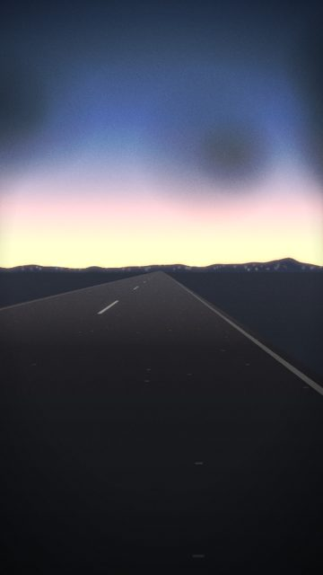

- **What you see:** Blue-hour drive; the streetlamps go out one by one as the sky lightens.
- **Emotional role:** the night ending behind you
- **Lyric match:** Grooving till the bar kicks us out
- **Sections:** outro · **Energy:** low · **Colour:** dawn cyan / peach
- **Reacts to music:** lamps off on staggered beats from lampsOffAt
- **Good for:** endcard, story · **Used in:** R19, R21
- **Generator:** `road` `{"sky":"dawn","lampsOffAt":214,"moon":false,"stars":0}`

## S017 - Tunnel into morning

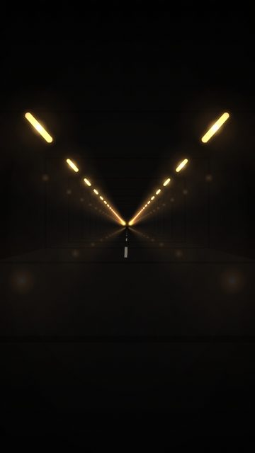

- **What you see:** Tunnel exit opens on a peach dawn instead of night.
- **Emotional role:** coming out the other side
- **Lyric match:** We rise and we fall
- **Sections:** drop2, outro · **Energy:** mid · **Colour:** sodium / peach
- **Reacts to music:** exit at exitAt
- **Good for:** endcard
- **Generator:** `tunnel` `{"exitColor":"#f3b58e","exitAt":210}`

## S021 - First train home

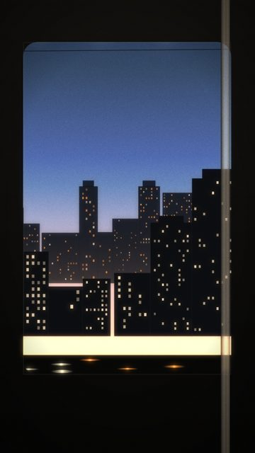

- **What you see:** The same ride at blue hour, a few windows still on.
- **Emotional role:** the ride home
- **Lyric match:** Grooving till the bar kicks us out
- **Sections:** outro, breakdown · **Energy:** low · **Colour:** dawn / pale
- **Reacts to music:** masts on travel
- **Good for:** endcard, story
- **Generator:** `train` `{"sky":"dawn","moon":false,"windowColor":"#ffe6c4"}`

## S025 - City closing

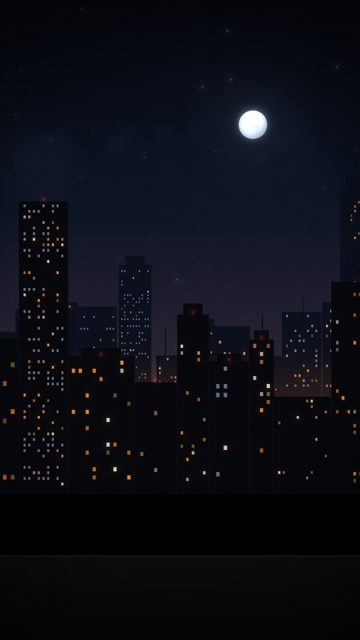

- **What you see:** From modeAt, a slice of windows goes dark on every beat.
- **Emotional role:** the night shutting down around you
- **Lyric match:** grooving till the bar kicks us out
- **Sections:** breakdown, outro · **Energy:** low · **Colour:** fading amber
- **Reacts to music:** windows off per beat after modeAt
- **Good for:** story · **Used in:** R04, R21
- **Generator:** `skyline` `{"mode":"closing","modeAt":105}`

## S029 - Skyline at first light

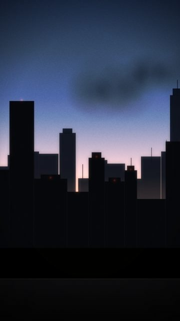

- **What you see:** Pale sky, windows mostly dark.
- **Emotional role:** afterglow
- **Lyric match:** Grooving till the bar kicks us out
- **Sections:** outro · **Energy:** low · **Colour:** dawn peach / slate
- **Reacts to music:** remaining windows switch off per beat
- **Good for:** endcard
- **Generator:** `skyline` `{"sky":"dawn","moon":false,"stars":0,"mode":"closing","modeAt":0}`

## S044 - Stars at blue hour

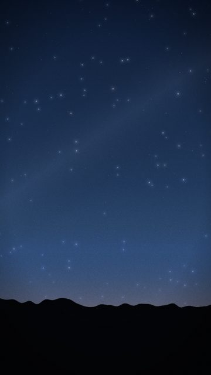

- **What you see:** Fading stars in a lifting blue sky.
- **Emotional role:** it's getting light
- **Lyric match:** We rise and we fall
- **Sections:** outro · **Energy:** low · **Colour:** blue
- **Reacts to music:** slow rotation
- **Good for:** endcard
- **Generator:** `stars` `{"sky":"blue","hillLights":false}`

## S049 - Sunrise behind the city

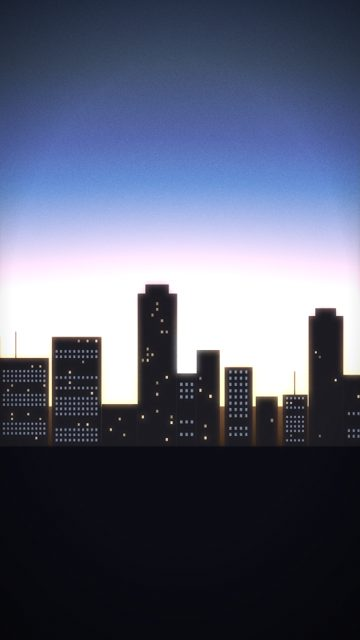

- **What you see:** The sun coming up behind the skyline at the end of the night.
- **Emotional role:** afterglow
- **Lyric match:** We rise and we fall
- **Sections:** outro · **Energy:** low · **Colour:** peach / slate
- **Reacts to music:** slow sun lift
- **Good for:** endcard · **Used in:** R19, R21
- **Generator:** `backlight` `{"variant":"rise"}`

## S055 - Bar, nearly empty

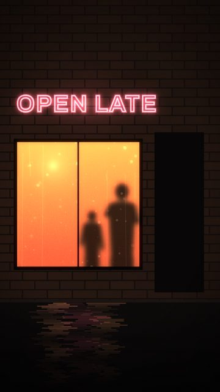

- **What you see:** Two shapes left inside, door shut.
- **Emotional role:** the last ones
- **Lyric match:** Oh, oh
- **Sections:** breakdown · **Energy:** low · **Colour:** dim rose
- **Reacts to music:** slow sway
- **Good for:** story
- **Generator:** `bar` `{"crowd":2,"door":0,"sign":"OPEN LATE"}`

## S079 - Amber flashing at 4am

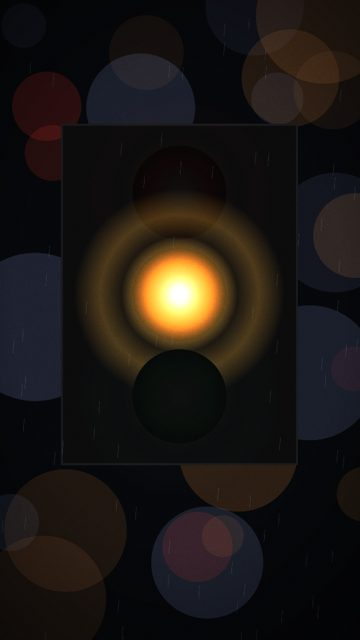

- **What you see:** After-hours amber flashing on the beat.
- **Emotional role:** nobody's driving now
- **Lyric match:** Oh, oh
- **Sections:** breakdown, outro · **Energy:** low · **Colour:** amber
- **Reacts to music:** flash on every beat
- **Good for:** texture, loop
- **Generator:** `signal` `{"kind":"traffic","flashAmber":true,"rain":0.3}`

## S087 - Clock: 04:44

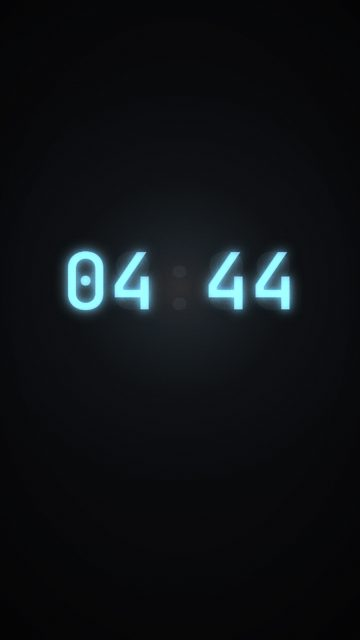

- **What you see:** Cold-blue clock at the end of the night.
- **Emotional role:** where did the night go
- **Lyric match:** -
- **Sections:** outro · **Energy:** low · **Colour:** cyan
- **Reacts to music:** colon on the beat
- **Good for:** endcard
- **Generator:** `clock` `{"at":"04:44","songAt":210,"color":"#86b7cc"}`

## S094 - Bokeh, dawn

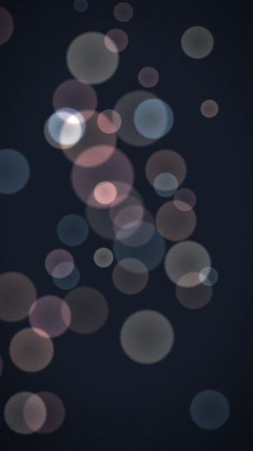

- **What you see:** Peach and cyan discs on slate.
- **Emotional role:** afterglow
- **Lyric match:** -
- **Sections:** outro · **Energy:** low · **Colour:** peach / cyan
- **Reacts to music:** -
- **Good for:** endcard
- **Generator:** `bokeh` `{"palette":"dawn"}`

## S103 - Facade, cold

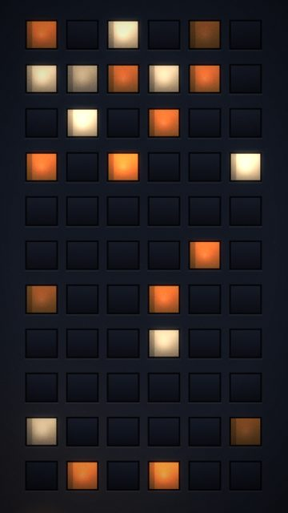

- **What you see:** Bluer concrete, fewer lights.
- **Emotional role:** late
- **Lyric match:** -
- **Sections:** outro · **Energy:** low · **Colour:** blue
- **Reacts to music:** -
- **Good for:** texture
- **Generator:** `facade` `{"tone":"#121722"}`
