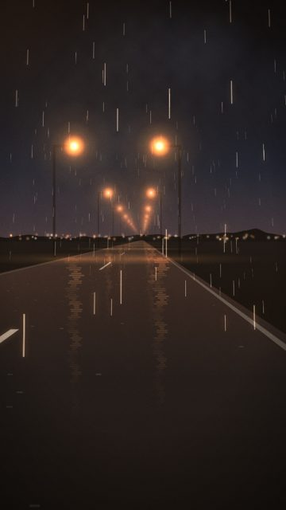
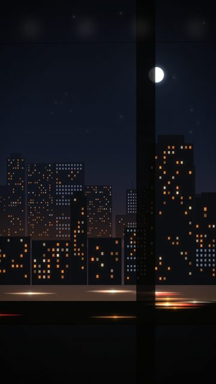
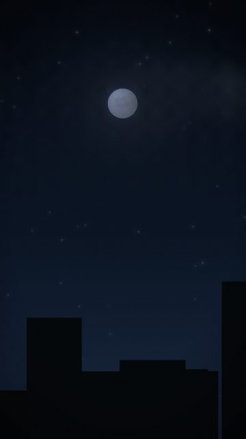
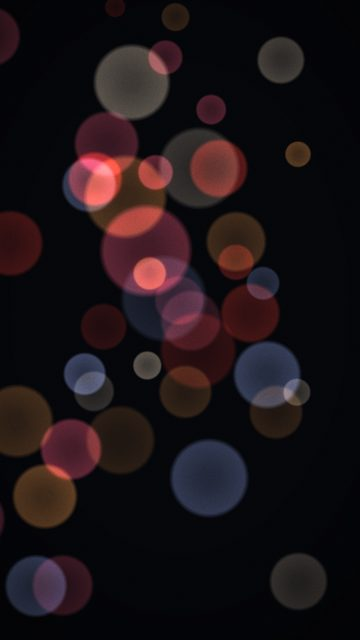
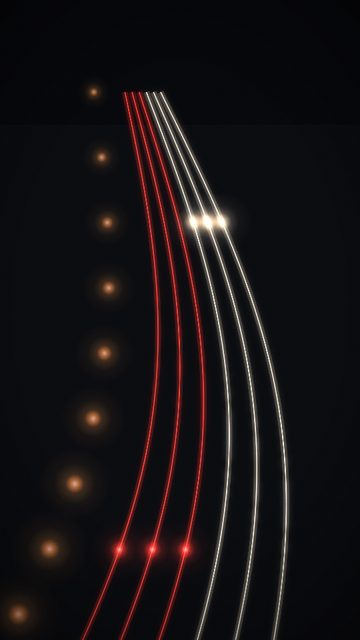
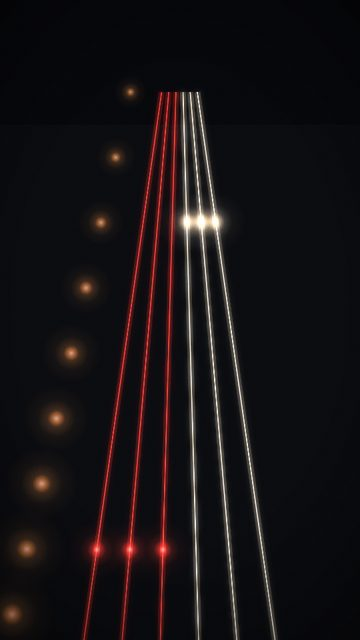
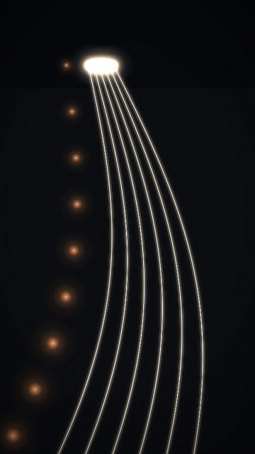

# City motion

8 shots. Preview any of them in Remotion Studio under **Shots / Shot-<ID>**.

## S002 - Rain on the road

- **What you see:** Same POV in heavy rain, lamps both sides, rain streaks lit only when a lamp is close.
- **Emotional role:** pushing through, not stopping
- **Lyric match:** Take a chance, rolling it twice
- **Sections:** build1, build2, drop2 · **Energy:** high · **Colour:** wet amber / black
- **Reacts to music:** lamps pass at the track's travel rate: 1 per bar in the intro, 1 per beat (on the kick) in verses/drops, 8ths/16ths in the build rolls; rain brightens on each pass
- **Good for:** drop, build · **Used in:** R15
- **Generator:** `road` `{"lamps":"both","rain":0.8,"wet":1,"moon":false,"fog":0.8,"stars":0}`

## S023 - City stream, no frame

- **What you see:** Just the layered city streaming right-to-left, no carriage.
- **Emotional role:** the city as a blur of other people's nights
- **Lyric match:** Moving my feet...
- **Sections:** drop1, verse1b · **Energy:** mid · **Colour:** sodium / ink
- **Reacts to music:** layers scroll with travel
- **Good for:** drop, texture · **Used in:** R12
- **Generator:** `train` `{"frame":"none","dir":-1}`

## S036 - The moon follows (rooftops)

- **What you see:** Rooftops stream along the bottom edge under a fixed moon.
- **Emotional role:** the city moving under you
- **Lyric match:** Moving to the music
- **Sections:** drop1, drop2 · **Energy:** mid · **Colour:** black / moon
- **Reacts to music:** roofs on travel()
- **Good for:** drop · **Used in:** R12, R17
- **Generator:** `moon` `{"variant":"follow","foreground":"roofs","r":64,"y":0.24}`

## S091 - Bokeh, mixed

- **What you see:** Red, amber, white and blue discs.
- **Emotional role:** a busy night, out of focus
- **Lyric match:** Moving to the music
- **Sections:** drop1, verse1b · **Energy:** mid · **Colour:** mixed
- **Reacts to music:** kick
- **Good for:** texture
- **Generator:** `bokeh` `{}`

## S092 - Rack focus to sharp

- **What you see:** Soft discs snap into sharp points at rackAt.
- **Emotional role:** clarity
- **Lyric match:** telling the truth
- **Sections:** build1, drop1 · **Energy:** mid · **Colour:** mixed
- **Reacts to music:** rack at rackAt
- **Good for:** reveal
- **Generator:** `bokeh` `{"rackTo":1,"rackAt":60}`

## S095 - Light trails, curve

- **What you see:** Long-exposure lanes curving below an overpass; a pulse rides down the lanes on each kick.
- **Emotional role:** the city flowing
- **Lyric match:** Moving to the music
- **Sections:** drop1, drop2 · **Energy:** high · **Colour:** red / white
- **Reacts to music:** lane pulse per kick
- **Good for:** drop, loop · **Used in:** R12, R15, R16
- **Generator:** `trails` `{}`

## S096 - Light trails, straight

- **What you see:** Straight lanes, symmetrical.
- **Emotional role:** direction
- **Lyric match:** where you're goin
- **Sections:** verse2 · **Energy:** mid · **Colour:** red / white
- **Reacts to music:** kick
- **Good for:** texture
- **Generator:** `trails` `{"curve":0}`

## S098 - Arriving (all white)

- **What you see:** Only headlights: everyone coming in.
- **Emotional role:** the night arriving
- **Lyric match:** Moving my feet
- **Sections:** verse1b · **Energy:** mid · **Colour:** white
- **Reacts to music:** kick
- **Good for:** texture
- **Generator:** `trails` `{"red":0}`
