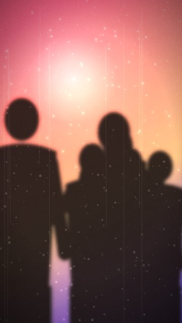
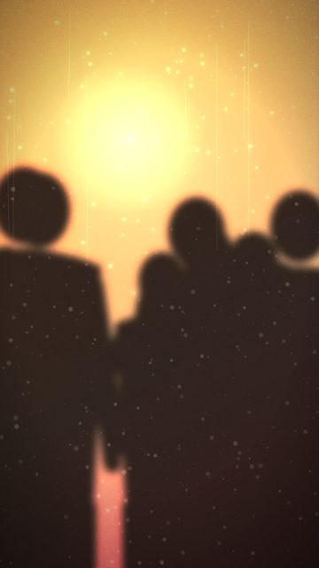
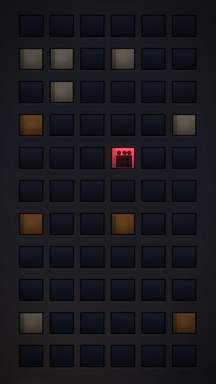

# Dancing

4 shots. Preview any of them in Remotion Studio under **Shots / Shot-<ID>**.

## S057 - Frosted glass, warm

- **What you see:** Close on steamed glass: blurred bodies dancing behind it, arms up on the heavy bass bars.
- **Emotional role:** inside the moment
- **Lyric match:** Moving to the music, grooving
- **Sections:** drop1, drop2 · **Energy:** high · **Colour:** amber / rose
- **Reacts to music:** bounce on kick, sway on beat, arms on bass bar
- **Good for:** drop, loop · **Used in:** R11, R12, R13, R21
- **Generator:** `frosted` `{}`

## S058 - Frosted glass, rose

- **What you see:** Same, cooler rose/violet light swapping every bar.
- **Emotional role:** late, louder
- **Lyric match:** grooving till the bar kicks us out
- **Sections:** drop2 · **Energy:** high · **Colour:** rose / violet
- **Reacts to music:** light swaps per bar
- **Good for:** drop · **Used in:** R13, R16
- **Generator:** `frosted` `{"hue":"#ff5a7a","hue2":"#7a5aff"}`

## S059 - Frosted crowd

- **What you see:** Packed: fifteen shapes, heavier blur.
- **Emotional role:** everyone
- **Lyric match:** Moving to the music
- **Sections:** drop1, drop2 · **Energy:** high · **Colour:** amber
- **Reacts to music:** kick + bass
- **Good for:** drop · **Used in:** R11, R13
- **Generator:** `frosted` `{"count":15,"blur":12}`

## S102 - Facade, one flat partying

- **What you see:** A whole dark block and one window full of moving people.
- **Emotional role:** the party you can see from the street
- **Lyric match:** grooving
- **Sections:** drop1, drop2 · **Energy:** mid · **Colour:** rose window
- **Reacts to music:** silhouettes bounce on kick
- **Good for:** story · **Used in:** R12, R13
- **Generator:** `facade` `{"mode":"party"}`
