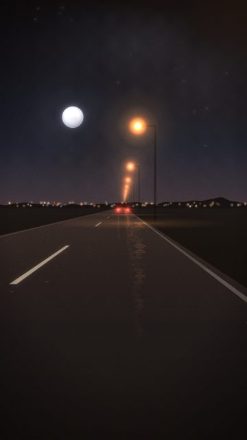
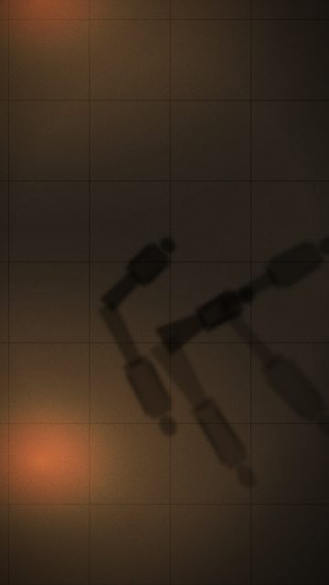
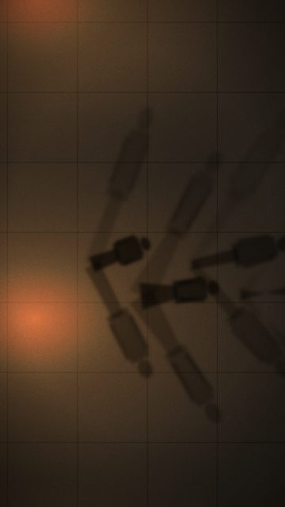
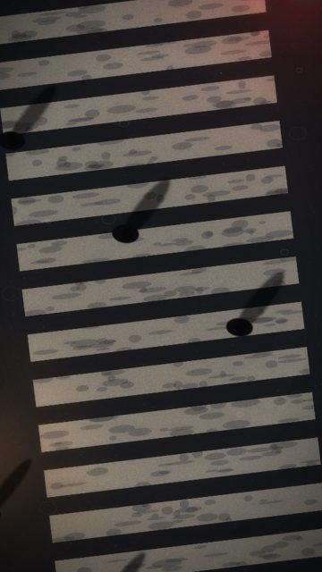

# Friends / group energy

4 shots. Preview any of them in Remotion Studio under **Shots / Shot-<ID>**.

## S005 - Following their taillights

- **What you see:** A car ahead, two red taillights drifting in the lane: friends in the other car.
- **Emotional role:** following someone into the night
- **Lyric match:** It's not where you been, it's about where you're goin
- **Sections:** verse1a, verse1b, verse2 · **Energy:** mid · **Colour:** red tail / sodium
- **Reacts to music:** lamps pass at the track's travel rate: 1 per bar in the intro, 1 per beat (on the kick) in verses/drops, 8ths/16ths in the build rolls
- **Good for:** story · **Used in:** R05
- **Generator:** `road` `{"tail":true,"lamps":"right"}`

## S069 - Three shadows walking

- **What you see:** Looking down at the pavement: three friends' shadows swing round and stretch as each lamp passes.
- **Emotional role:** the walk out
- **Lyric match:** Moving my feet to the beat of a drum
- **Sections:** verse1a, verse1b, breakdown · **Energy:** mid · **Colour:** sodium pools / concrete
- **Reacts to music:** lamps pass on travel()
- **Good for:** story, loop · **Used in:** R01, R11
- **Generator:** `shadows` `{}`

## S072 - A crowd of shadows

- **What you see:** Six overlapping shadows, closer lamps.
- **Emotional role:** everyone spilling out
- **Lyric match:** grooving till the bar kicks us out
- **Sections:** breakdown, drop2 · **Energy:** mid · **Colour:** sodium
- **Reacts to music:** lamps on travel()
- **Good for:** story · **Used in:** R07
- **Generator:** `shadows` `{"people":6,"spacing":0.8}`

## S076 - Crosswalk crowd

- **What you see:** Seven people crossing at once.
- **Emotional role:** a group with no plan
- **Lyric match:** Moving my feet
- **Sections:** verse1a, drop1 · **Energy:** mid · **Colour:** red / grey
- **Reacts to music:** -
- **Good for:** story · **Used in:** R16
- **Generator:** `crosswalk` `{"people":7}`
