# Moonlight / night sky

13 shots. Preview any of them in Remotion Studio under **Shots / Shot-<ID>**.

## S012 - Big moon over the road

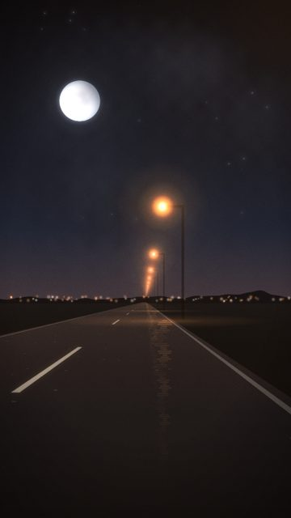

- **What you see:** Lower horizon, more sky, oversized moon that never moves while the lamps rush past.
- **Emotional role:** the one thing that stays
- **Lyric match:** I promise to say it in the moonlight
- **Sections:** verse1b, verse2 · **Energy:** mid · **Colour:** moon blue / sodium
- **Reacts to music:** lamps pass at the track's travel rate: 1 per bar in the intro, 1 per beat (on the kick) in verses/drops, 8ths/16ths in the build rolls; moon fixed
- **Good for:** loop, lyric · **Used in:** R02, R14, R17, R19
- **Generator:** `road` `{"horizon":0.58,"moonR":74,"moonX":0.28,"moonY":0.2,"lamps":"right"}`

## S030 - Skyline under a big moon

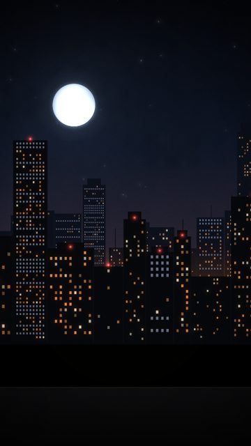

- **What you see:** Oversized moon over the skyline, lots of sky for type.
- **Emotional role:** a promise over the city
- **Lyric match:** I promise to say it in the moonlight
- **Sections:** verse1b, verse2 · **Energy:** low · **Colour:** moon blue / amber
- **Reacts to music:** beacons on kick
- **Good for:** lyric, loop
- **Generator:** `skyline` `{"moonR":90,"moonY":0.24,"moonX":0.3}`

## S032 - The moon, clouds crossing

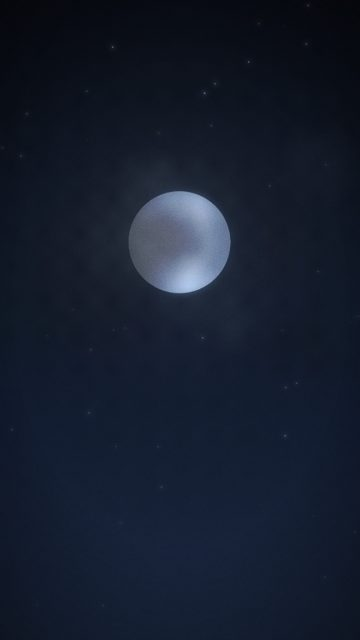

- **What you see:** Big centred moon, soft halo, thin clouds drifting across.
- **Emotional role:** truth, said quietly
- **Lyric match:** I promise to say it in the moonlight
- **Sections:** verse1b, breakdown, verse2 · **Energy:** low · **Colour:** moon white / navy
- **Reacts to music:** halo breathes on the kick in drops
- **Good for:** lyric, loop · **Used in:** R02
- **Generator:** `moon` `{}`

## S033 - Small high moon

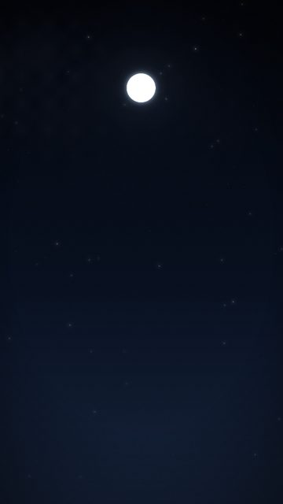

- **What you see:** A small moon high in frame, the rest is empty night: negative space.
- **Emotional role:** alone with a thought
- **Lyric match:** If I took it alive
- **Sections:** intro, verse1b · **Energy:** low · **Colour:** navy / white
- **Reacts to music:** halo on kick
- **Good for:** lyric, tease · **Used in:** R04, R15
- **Generator:** `moon` `{"r":54,"y":0.18,"cloudAlpha":0.25}`

## S034 - The moon follows (wires)

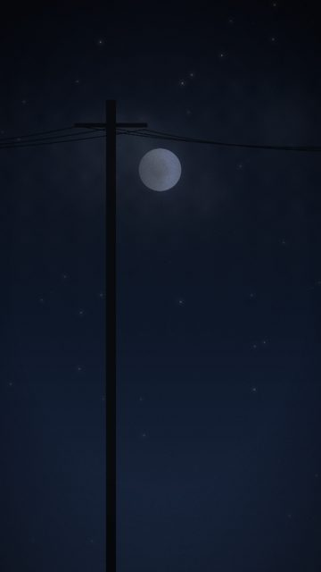

- **What you see:** Telegraph poles and wires race past, one per travel unit; the moon stays fixed.
- **Emotional role:** everything passes except this
- **Lyric match:** I promise to say it in the moonlight
- **Sections:** verse1b, verse2, drop1 · **Energy:** mid · **Colour:** black wires / moon
- **Reacts to music:** poles pass on travel()
- **Good for:** loop, story · **Used in:** R02, R12, R19
- **Generator:** `moon` `{"variant":"follow","foreground":"wires","r":70,"y":0.3}`

## S035 - The moon follows (trees)

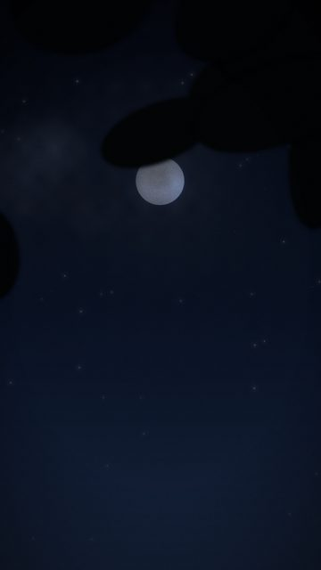

- **What you see:** Out-of-focus branches whip past in front of a steady moon.
- **Emotional role:** leaving town
- **Lyric match:** It's not where you been...
- **Sections:** verse1a, verse2 · **Energy:** mid · **Colour:** soft black / moon
- **Reacts to music:** branches on travel()
- **Good for:** story · **Used in:** R05
- **Generator:** `moon` `{"variant":"follow","foreground":"branches","r":80,"y":0.32}`

## S037 - Moon on black water

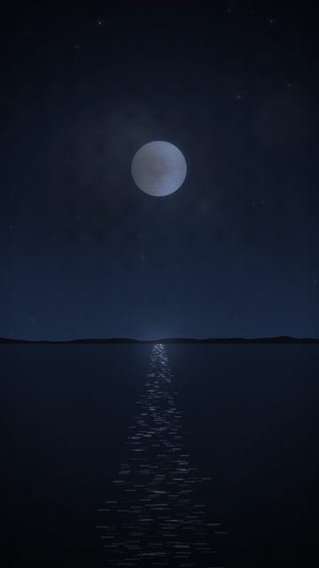

- **What you see:** Moon over still water; the glitter path shivers with the hats.
- **Emotional role:** honest and calm
- **Lyric match:** I'm taking my time, telling the truth
- **Sections:** verse1b, breakdown, verse2 · **Energy:** low · **Colour:** silver / black
- **Reacts to music:** glitter follows the hat envelope
- **Good for:** lyric, loop · **Used in:** R06, R07
- **Generator:** `moon` `{"variant":"water","y":0.3,"r":92}`

## S038 - Moonrise

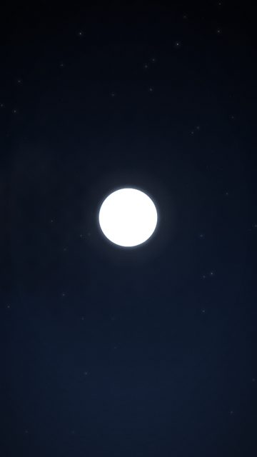

- **What you see:** A warm low moon rising during the first seconds of the shot.
- **Emotional role:** the night beginning
- **Lyric match:** If I took it alive
- **Sections:** intro · **Energy:** low · **Colour:** warm moon / dusk
- **Reacts to music:** halo on kick
- **Good for:** tease
- **Generator:** `moon` `{"rise":1,"r":120,"y":0.45,"warm":1}`

## S039 - Moon, heavy cloud

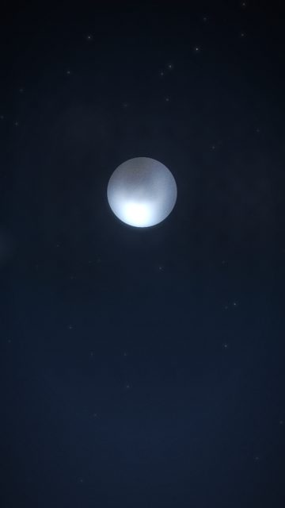

- **What you see:** Faster, thicker clouds keep hiding and revealing the moon.
- **Emotional role:** what you almost said
- **Lyric match:** Out of sight, out of mind
- **Sections:** build1, build2 · **Energy:** mid · **Colour:** grey / white
- **Reacts to music:** cloud speed constant
- **Good for:** build, tease · **Used in:** R04
- **Generator:** `moon` `{"cloudAlpha":0.75,"cloudSpeed":30,"r":130}`

## S040 - Star field

- **What you see:** Dense, varied star field rotating slowly over dark hills and a far town.
- **Emotional role:** ambition, quiet
- **Lyric match:** Shoot for the stars
- **Sections:** verse2, breakdown · **Energy:** low · **Colour:** white / navy
- **Reacts to music:** slow rotation
- **Good for:** lyric, loop · **Used in:** R08
- **Generator:** `stars` `{}`

## S045 - Stars, nobody around

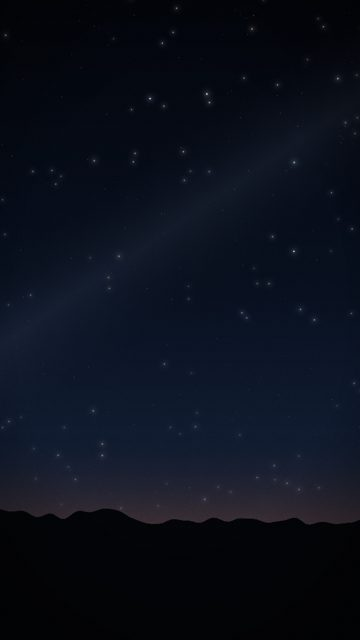

- **What you see:** Stars and black hills only.
- **Emotional role:** smallness, in a good way
- **Lyric match:** living forever young
- **Sections:** breakdown · **Energy:** low · **Colour:** black / white
- **Reacts to music:** slow rotation
- **Good for:** texture
- **Generator:** `stars` `{"hillLights":false,"rotate":0.02}`

## S064 - Neon: moonlight

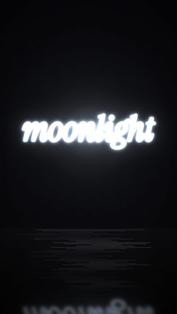

- **What you see:** Song title in serif neon on a dark wall.
- **Emotional role:** identity
- **Lyric match:** say it in the moonlight
- **Sections:** verse1b, verse2, drop2 · **Energy:** mid · **Colour:** moon blue
- **Reacts to music:** tube buzz
- **Good for:** endcard, reveal · **Used in:** R17
- **Generator:** `neon` `{"lines":["moonlight"],"font":"serif","size":210,"color":"#c9dcf2","wall":"dark"}`

## S093 - Bokeh, cold

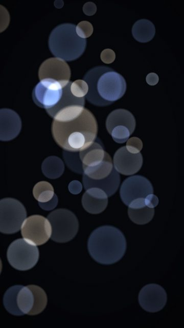

- **What you see:** Moon-blue discs.
- **Emotional role:** distance
- **Lyric match:** Out of sight, out of mind
- **Sections:** verse2 · **Energy:** low · **Colour:** blue
- **Reacts to music:** kick
- **Good for:** texture
- **Generator:** `bokeh` `{"palette":"cool"}`
