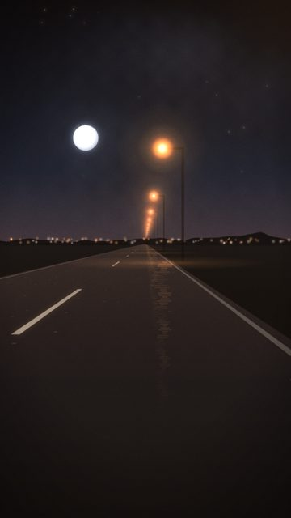
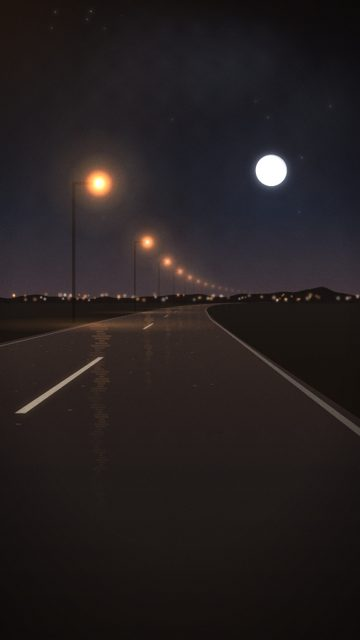
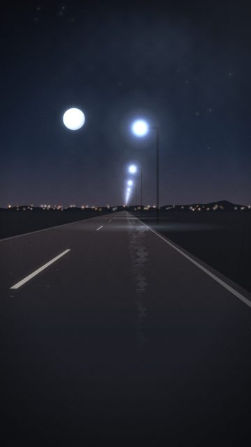
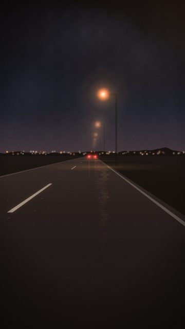
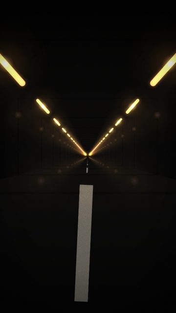
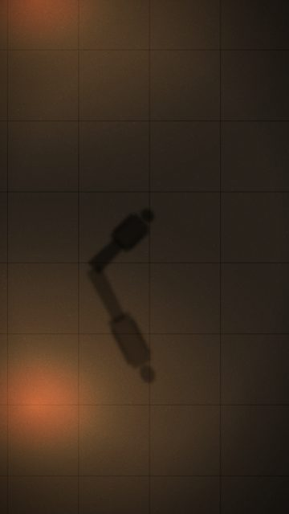
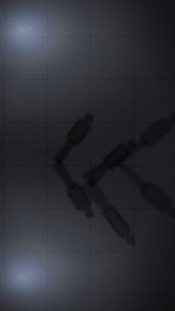
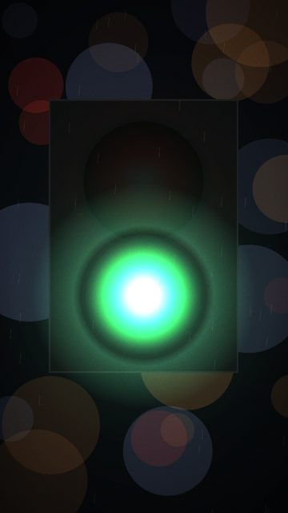
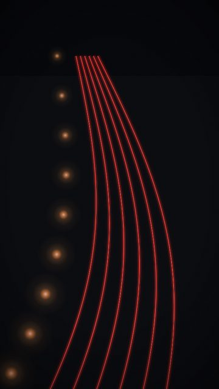

# Movement / walking / driving

10 shots. Preview any of them in Remotion Studio under **Shots / Shot-<ID>**.

## S001 - The drive, moon on the left

- **What you see:** POV down an empty two-lane road at night. Sodium lamps on the right, a fixed moon top-left, a town glowing on the horizon.
- **Emotional role:** moving without a destination
- **Lyric match:** Moving my feet to the beat of a drum
- **Sections:** verse1b, drop1, drop2 · **Energy:** mid · **Colour:** sodium orange / ink navy
- **Reacts to music:** lamps pass at the track's travel rate: 1 per bar in the intro, 1 per beat (on the kick) in verses/drops, 8ths/16ths in the build rolls
- **Good for:** story, drop, loop · **Used in:** R05, R09, R10, R20
- **Generator:** `road` `{"lamps":"right"}`

## S006 - Long left curve

- **What you see:** The road bends away to the left so the lamp line sweeps across frame.
- **Emotional role:** not knowing what's round the bend
- **Lyric match:** It's not where you been...
- **Sections:** verse1b, verse2 · **Energy:** mid · **Colour:** sodium / navy
- **Reacts to music:** lamps pass at the track's travel rate: 1 per bar in the intro, 1 per beat (on the kick) in verses/drops, 8ths/16ths in the build rolls
- **Good for:** story, build
- **Generator:** `road` `{"curve":0.7,"lamps":"left","moonX":0.75}`

## S009 - Cold LED road

- **What you see:** Same drive under white LED lamps: colder, more honest light.
- **Emotional role:** telling the truth
- **Lyric match:** I'm taking my time, telling the truth
- **Sections:** verse1b, verse2 · **Energy:** mid · **Colour:** cold white / navy
- **Reacts to music:** lamps pass at the track's travel rate: 1 per bar in the intro, 1 per beat (on the kick) in verses/drops, 8ths/16ths in the build rolls
- **Good for:** lyric · **Used in:** R06
- **Generator:** `road` `{"lampColor":"#cfe0ff","sky":"night","moonX":0.3}`

## S010 - Fog drive

- **What you see:** Thick fog: lamps appear late and bloom, taillights barely visible.
- **Emotional role:** not knowing where it ends
- **Lyric match:** Out of sight, out of mind
- **Sections:** intro, build1 · **Energy:** low · **Colour:** smoky amber
- **Reacts to music:** lamps pass at the track's travel rate: 1 per bar in the intro, 1 per beat (on the kick) in verses/drops, 8ths/16ths in the build rolls
- **Good for:** tease, build · **Used in:** R09
- **Generator:** `road` `{"fog":1.6,"moon":false,"stars":0,"tail":true}`

## S013 - Tunnel, exit on the drop

- **What you see:** Inside a tunnel, ceiling fixtures streak past; an opening grows and the camera bursts out at exitAt.
- **Emotional role:** the build as a tunnel, the drop as the sky
- **Lyric match:** grooving till the bar kicks us out
- **Sections:** build1, build2 · **Energy:** high · **Colour:** sodium streaks / white burst
- **Reacts to music:** fixtures at 16ths of travel; exit flash at exitAt
- **Good for:** drop, build · **Used in:** R09, R14
- **Generator:** `tunnel` `{"exitAt":60}`

## S071 - One shadow

- **What you see:** A single shadow under the lamps.
- **Emotional role:** on your own, still going
- **Lyric match:** I'm taking my time
- **Sections:** verse1b, breakdown · **Energy:** low · **Colour:** sodium
- **Reacts to music:** lamps on travel()
- **Good for:** lyric · **Used in:** R04
- **Generator:** `shadows` `{"people":1}`

## S073 - Shadows under LED

- **What you see:** Cooler white light, harder shadows.
- **Emotional role:** sober moment
- **Lyric match:** telling the truth
- **Sections:** verse2 · **Energy:** low · **Colour:** cold white
- **Reacts to music:** lamps on travel()
- **Good for:** lyric
- **Generator:** `shadows` `{"lampColor":"#d6e4ff","tone":"#2a2c30"}`

## S080 - Walk, green

- **What you see:** The walk light is already green; it pulses on the kick.
- **Emotional role:** go now
- **Lyric match:** Moving my feet
- **Sections:** verse1b, drop1 · **Energy:** mid · **Colour:** green
- **Reacts to music:** green glow on kick
- **Good for:** texture
- **Generator:** `signal` `{"kind":"walk","goAt":0,"rain":0.2}`

## S097 - Leaving (all red)

- **What you see:** Only taillights: everyone leaving.
- **Emotional role:** out of sight
- **Lyric match:** Out of sight, out of mind
- **Sections:** build2 · **Energy:** mid · **Colour:** red
- **Reacts to music:** kick
- **Good for:** lyric · **Used in:** R04
- **Generator:** `trails` `{"red":1}`

## S107 - Footstep in the puddle

- **What you see:** A foot lands in the moon at `step` (default: the drop) and the reflection shatters.
- **Emotional role:** the moment you go
- **Lyric match:** kicks us OUT
- **Sections:** drop1, drop2 · **Energy:** high · **Colour:** black / moon
- **Reacts to music:** splash at step
- **Good for:** drop, reveal · **Used in:** R15
- **Generator:** `puddle` `{"step":60,"rings":"none"}`
