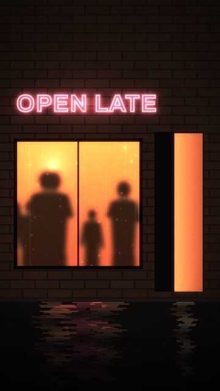
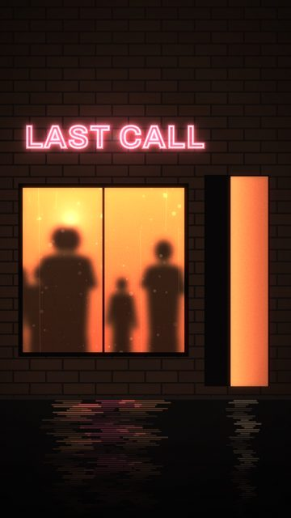
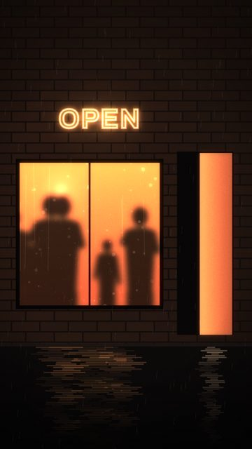
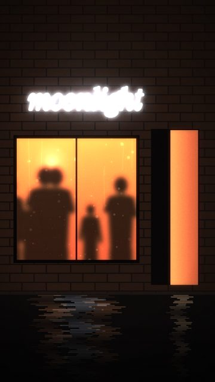
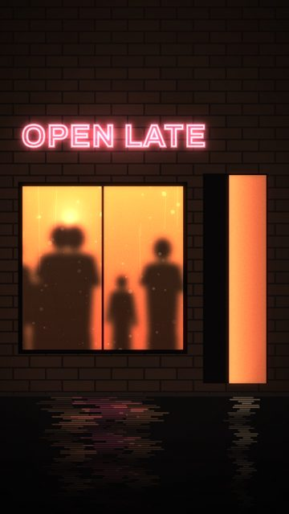
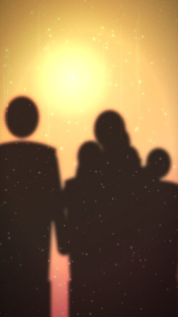
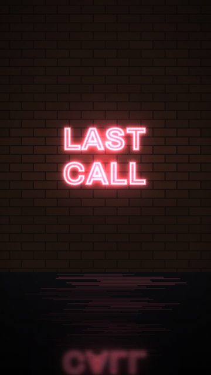
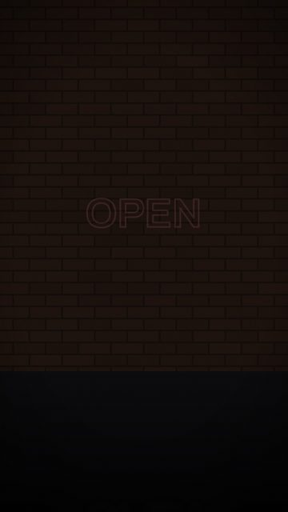
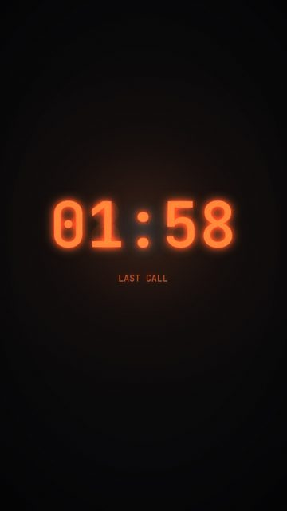
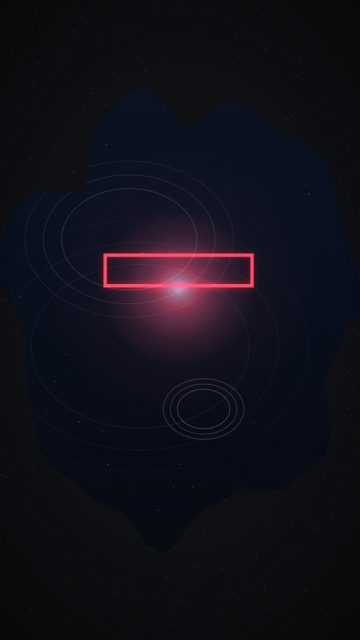

# Nightlife

10 shots. Preview any of them in Remotion Studio under **Shots / Shot-<ID>**.

## S051 - Bar, open late

- **What you see:** Brick front, rose neon OPEN LATE, steamed window with shapes dancing, open door spilling light on wet pavement.
- **Emotional role:** the place you don't want to leave
- **Lyric match:** Moving to the music
- **Sections:** drop1, drop2 · **Energy:** high · **Colour:** rose neon / amber
- **Reacts to music:** dancers move with kick + bass
- **Good for:** story · **Used in:** R11, R13
- **Generator:** `bar` `{}`

## S052 - Bar, last call

- **What you see:** At closeAt the neon dies and the inside lights drop beat by beat; the door goes dark.
- **Emotional role:** the bar kicks us out
- **Lyric match:** grooving till the bar kicks us out
- **Sections:** drop1, breakdown · **Energy:** mid · **Colour:** rose -> black
- **Reacts to music:** neon off + lights off per beat at closeAt
- **Good for:** story, reveal · **Used in:** R11, R21
- **Generator:** `bar` `{"sign":"LAST CALL","closeAt":105}`

## S053 - Bar in the rain

- **What you see:** Same front in rain, amber sign.
- **Emotional role:** warmth from the outside
- **Lyric match:** Moving my feet...
- **Sections:** verse1b · **Energy:** mid · **Colour:** amber / wet black
- **Reacts to music:** dancers on kick
- **Good for:** story, texture
- **Generator:** `bar` `{"rain":0.8,"sign":"OPEN","signColor":"#ffa04a"}`

## S054 - Bar, serif sign

- **What you see:** The bar is called moonlight; cold serif neon.
- **Emotional role:** the place the song is named after
- **Lyric match:** say it in the moonlight
- **Sections:** verse2, drop2 · **Energy:** mid · **Colour:** cold neon / amber
- **Reacts to music:** dancers on kick
- **Good for:** reveal, endcard · **Used in:** R17
- **Generator:** `bar` `{"sign":"moonlight","signFont":"serif","signColor":"#c9dcf2"}`

## S056 - Bar, sign flickers on

- **What you see:** Neon stutters on at onAt.
- **Emotional role:** here we go again
- **Lyric match:** Shoot for the stars
- **Sections:** verse2 · **Energy:** mid · **Colour:** rose
- **Reacts to music:** neon on at onAt
- **Good for:** reveal
- **Generator:** `bar` `{"onAt":120}`

## S060 - Frosted, lights out

- **What you see:** Dancers behind glass until closeAt, then dark.
- **Emotional role:** kicked out
- **Lyric match:** grooving till the bar kicks us out
- **Sections:** drop1, breakdown · **Energy:** mid · **Colour:** amber -> black
- **Reacts to music:** off at closeAt
- **Good for:** story
- **Generator:** `frosted` `{"closeAt":105}`

## S061 - Neon: LAST CALL

- **What you see:** Rose neon on brick, reflected in wet ground.
- **Emotional role:** the clock running out
- **Lyric match:** grooving till the bar kicks us out
- **Sections:** drop1, build1 · **Energy:** mid · **Colour:** rose
- **Reacts to music:** tube buzz
- **Good for:** story, tease · **Used in:** R10, R11
- **Generator:** `neon` `{"lines":["LAST","CALL"]}`

## S062 - Neon: OPEN -> CLOSED

- **What you see:** The sign switches from OPEN to CLOSED at swapAt (default: the drop).
- **Emotional role:** the bar kicks us out
- **Lyric match:** grooving till the bar kicks us OUT
- **Sections:** build1, drop1 · **Energy:** high · **Colour:** rose
- **Reacts to music:** swap + stutter at swapAt
- **Good for:** reveal, drop · **Used in:** R10
- **Generator:** `neon` `{"lines":["OPEN"],"swapTo":["CLOSED"],"swapAt":60}`

## S089 - Clock: LAST CALL

- **What you see:** Clock with a LAST CALL caption.
- **Emotional role:** running out
- **Lyric match:** Out of sight, out of mind
- **Sections:** build1 · **Energy:** mid · **Colour:** ember
- **Reacts to music:** colon on the beat
- **Good for:** build · **Used in:** R10
- **Generator:** `clock` `{"at":"01:58","songAt":52.5,"label":"LAST CALL"}`

## S105 - Neon in a puddle

- **What you see:** A rose sign reflected and shivering on the offbeats.
- **Emotional role:** the bar from the street
- **Lyric match:** Moving to the music
- **Sections:** drop1, drop2 · **Energy:** mid · **Colour:** rose / black
- **Reacts to music:** rings on offbeats
- **Good for:** texture · **Used in:** R12, R13
- **Generator:** `puddle` `{"holds":"neon","rings":"hat"}`
