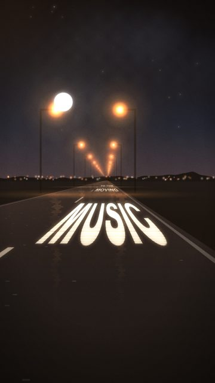
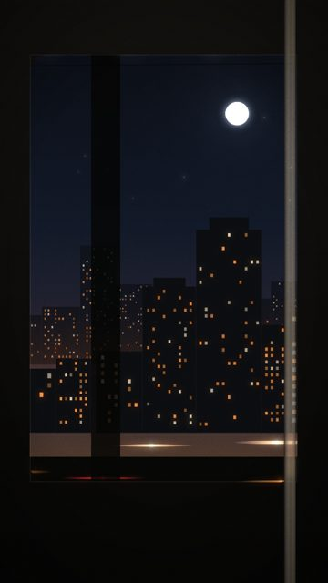
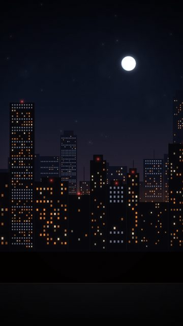
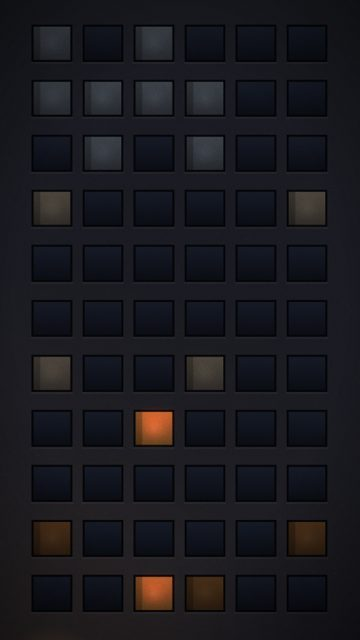
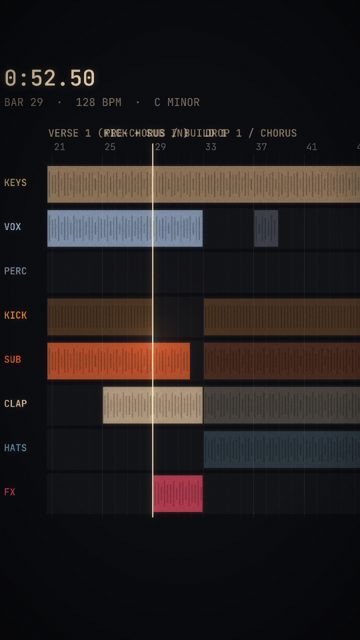
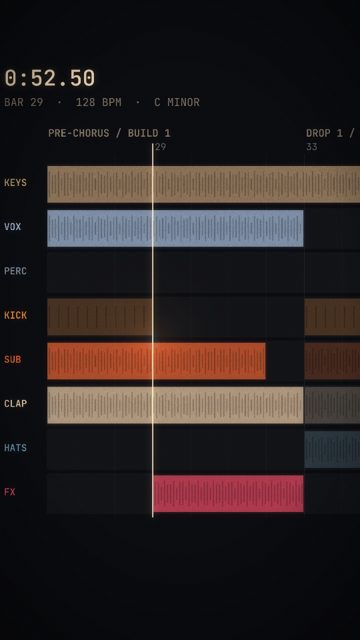
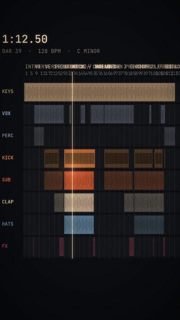
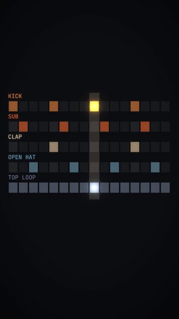

# Musical / rhythmic motion

9 shots. Preview any of them in Remotion Studio under **Shots / Shot-<ID>**.

## S011 - MOVING / TO THE / MUSIC painted

- **What you see:** Lyric painted on the road, one phrase per lamp, both sides lit.
- **Emotional role:** the road is the song
- **Lyric match:** Moving to the music
- **Sections:** build1, build2 · **Energy:** high · **Colour:** sodium / paint
- **Reacts to music:** lamps pass at the track's travel rate: 1 per bar in the intro, 1 per beat (on the kick) in verses/drops, 8ths/16ths in the build rolls
- **Good for:** lyric, drop · **Used in:** R09
- **Generator:** `road` `{"words":["MOVING","TO THE","MUSIC"],"wordGap":1,"lamps":"both"}`

## S022 - Tunnel blinks

- **What you see:** City through the window, blacked out for a beat whenever the train ducks under a bridge (set blinks to song times).
- **Emotional role:** the night flickering
- **Lyric match:** Moving to the music
- **Sections:** drop1, drop2 · **Energy:** high · **Colour:** black / sodium
- **Reacts to music:** blackouts on chosen beats
- **Good for:** drop
- **Generator:** `train` `{"blinks":[]}`

## S027 - City breathing with the bass

- **What you see:** A few windows swell with the bass envelope; beacons on the kick.
- **Emotional role:** the city hears it too
- **Lyric match:** Moving to the music
- **Sections:** drop1, drop2 · **Energy:** mid · **Colour:** amber / red beacons
- **Reacts to music:** bass envelope + kick
- **Good for:** drop, loop · **Used in:** R12
- **Generator:** `skyline` `{"mode":"pulse"}`

## S042 - Stars arrive on the beat

- **What you see:** Sky starts empty and fills a notch on every beat from fillFrom.
- **Emotional role:** counting up to something
- **Lyric match:** Shoot for the stars
- **Sections:** verse2, drop2 · **Energy:** mid · **Colour:** white / navy
- **Reacts to music:** reveal per beat
- **Good for:** build
- **Generator:** `stars` `{"variant":"fill"}`

## S101 - Facade as a sequencer

- **What you see:** Windows play the drop's real drum pattern: kick rows, clap rows, offbeat-hat rows.
- **Emotional role:** the city is the track
- **Lyric match:** Moving to the music
- **Sections:** drop1, drop2 · **Energy:** high · **Colour:** amber / white / blue
- **Reacts to music:** 16-step pattern, active only in drops
- **Good for:** drop, micro · **Used in:** R12, R18
- **Generator:** `facade` `{"mode":"sequencer"}`

## S109 - Arrangement, following

- **What you see:** Stylised arrangement built from the measured structure; playhead locked to the audio.
- **Emotional role:** the inside of the track
- **Lyric match:** -
- **Sections:** build1, drop1, build2 · **Energy:** mid · **Colour:** dark UI / warm clips
- **Reacts to music:** playhead = audio
- **Good for:** micro · **Used in:** R18
- **Generator:** `arrangement` `{}`

## S110 - Arrangement, zoomed on the drop

- **What you see:** Eight bars across the screen: you see the kick lane stop and restart.
- **Emotional role:** where the space is
- **Lyric match:** -
- **Sections:** build1, build2 · **Energy:** mid · **Colour:** dark UI
- **Reacts to music:** playhead
- **Good for:** micro · **Used in:** R18
- **Generator:** `arrangement` `{"zoomBars":8}`

## S111 - Whole song map

- **What you see:** All 121 bars on one screen, playhead travelling.
- **Emotional role:** the shape of the night
- **Lyric match:** -
- **Sections:** any · **Energy:** low · **Colour:** dark UI
- **Reacts to music:** playhead
- **Good for:** micro, endcard
- **Generator:** `arrangement` `{"zoomBars":121,"follow":false,"centerBar":61}`

## S112 - Drop step grid

- **What you see:** The drop's 16-step drum grid lighting up step by step.
- **Emotional role:** how it hits
- **Lyric match:** -
- **Sections:** drop1, drop2 · **Energy:** high · **Colour:** dark UI / amber
- **Reacts to music:** step = audio position
- **Good for:** micro, loop · **Used in:** R18
- **Generator:** `arrangement` `{"mode":"steps"}`
