# Risk / choice / moment

13 shots. Preview any of them in Remotion Studio under **Shots / Shot-<ID>**.

## S003 - OUT / OF / SIGHT painted

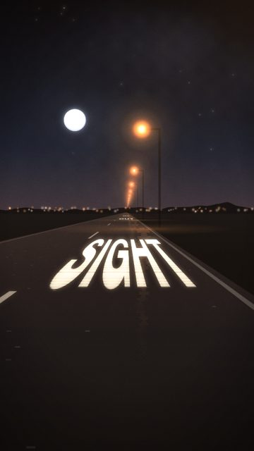

- **What you see:** Words painted on the asphalt approach and pass under the car, one every two lamps.
- **Emotional role:** the message is on the road ahead
- **Lyric match:** Out of sight, out of mind
- **Sections:** build1, build2 · **Energy:** mid · **Colour:** paint white / sodium
- **Reacts to music:** lamps pass at the track's travel rate: 1 per bar in the intro, 1 per beat (on the kick) in verses/drops, 8ths/16ths in the build rolls
- **Good for:** lyric, tease
- **Generator:** `road` `{"words":["OUT","OF","SIGHT"],"wordGap":2}`

## S004 - TAKE / A / CHANCE painted

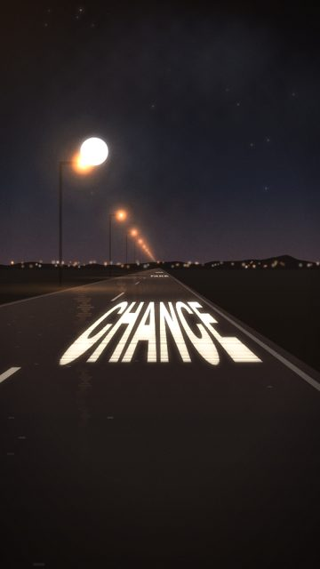

- **What you see:** Road markings spell the risk line, lamps on the left.
- **Emotional role:** commitment you drive over
- **Lyric match:** Take a chance, rolling it twice
- **Sections:** build1, build2 · **Energy:** mid · **Colour:** paint white / sodium
- **Reacts to music:** lamps pass at the track's travel rate: 1 per bar in the intro, 1 per beat (on the kick) in verses/drops, 8ths/16ths in the build rolls
- **Good for:** lyric, build
- **Generator:** `road` `{"words":["TAKE","A","CHANCE"],"wordGap":2,"lamps":"left"}`

## S015 - Tunnel words

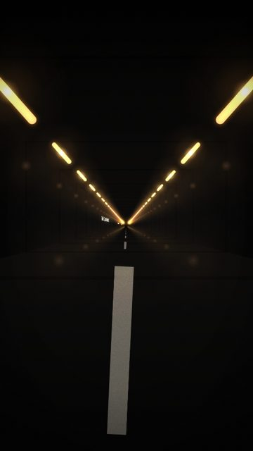

- **What you see:** Wall panels carry the lyric as the tunnel streaks by.
- **Emotional role:** the dare written on the wall
- **Lyric match:** Take a chance, rolling it twice
- **Sections:** build1, build2 · **Energy:** high · **Colour:** sodium / paint
- **Reacts to music:** panels every 4 travel units
- **Good for:** lyric, build
- **Generator:** `tunnel` `{"words":["TAKE A CHANCE","ROLLING IT TWICE"]}`

## S043 - Shooting star

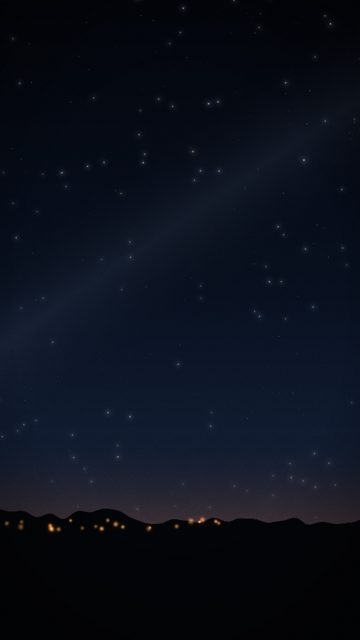

- **What you see:** A single shooting star crosses at shootAt (default: the silence after 'backs to the sun').
- **Emotional role:** the shot you take
- **Lyric match:** Shoot for the stars with our backs to the sun
- **Sections:** verse2 · **Energy:** low · **Colour:** white streak
- **Reacts to music:** streak at shootAt
- **Good for:** lyric, reveal · **Used in:** R08
- **Generator:** `stars` `{"shootAt":126.5}`

## S063 - Neon: OUT OF SIGHT

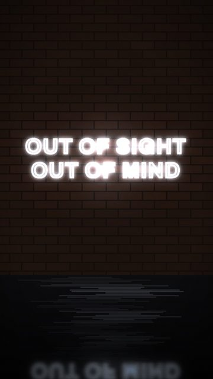

- **What you see:** The hook as a cold blue sign.
- **Emotional role:** forget it, keep moving
- **Lyric match:** Out of sight, out of mind
- **Sections:** build1, build2 · **Energy:** mid · **Colour:** ice blue
- **Reacts to music:** tube buzz
- **Good for:** lyric
- **Generator:** `neon` `{"lines":["OUT OF SIGHT","OUT OF MIND"],"size":104,"color":"#c9dcf2"}`

## S068 - Neon: TAKE A CHANCE

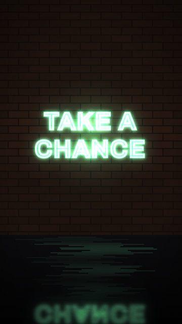

- **What you see:** Green neon dare.
- **Emotional role:** go
- **Lyric match:** Take a chance
- **Sections:** build1, build2 · **Energy:** mid · **Colour:** green
- **Reacts to music:** tube buzz
- **Good for:** lyric
- **Generator:** `neon` `{"lines":["TAKE A","CHANCE"],"color":"#6bffb0","size":140}`

## S077 - Walk signal countdown

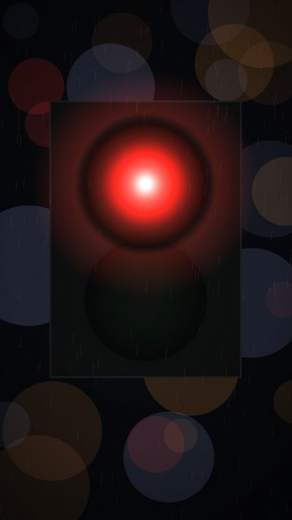

- **What you see:** Rain-blurred pedestrian signal; the amber digits count down one per beat and it goes green on goAt.
- **Emotional role:** waiting to go
- **Lyric match:** grooving till the bar kicks us out
- **Sections:** build1, build2 · **Energy:** high · **Colour:** red -> green
- **Reacts to music:** count per beat to goAt
- **Good for:** build, drop · **Used in:** R03
- **Generator:** `signal` `{"kind":"walk","goAt":60,"countFrom":8}`

## S078 - Traffic light on the drop

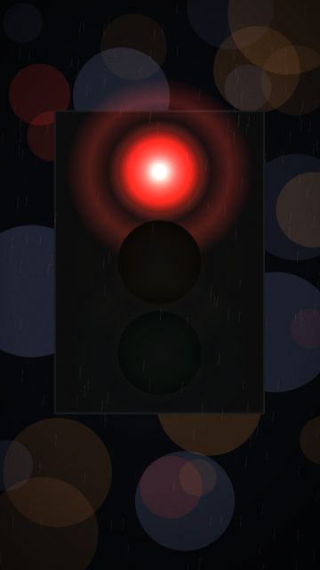

- **What you see:** Red holds through the build, green on goAt.
- **Emotional role:** permission
- **Lyric match:** Take a chance
- **Sections:** build1, build2 · **Energy:** high · **Colour:** red -> green
- **Reacts to music:** switch at goAt
- **Good for:** drop
- **Generator:** `signal` `{"kind":"traffic","goAt":60}`

## S081 - Red, dry night

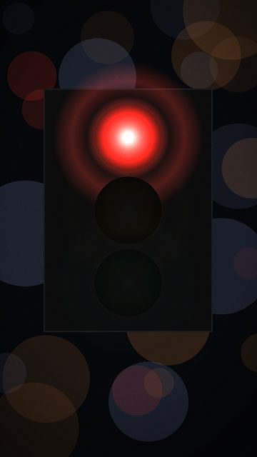

- **What you see:** A red light that doesn't change.
- **Emotional role:** the choice to wait or not
- **Lyric match:** Take a chance
- **Sections:** build1 · **Energy:** mid · **Colour:** red
- **Reacts to music:** -
- **Good for:** tease · **Used in:** R03
- **Generator:** `signal` `{"kind":"traffic","goAt":9999,"rain":0}`

## S082 - Dice, rolled twice

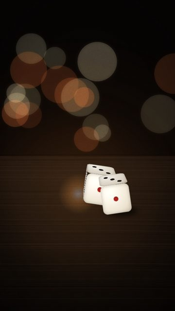

- **What you see:** Two dice thrown on a bar counter on 'take a chance', thrown again on 'rolling it twice'.
- **Emotional role:** the chance itself
- **Lyric match:** Take a chance, rolling it twice
- **Sections:** build1, build2 · **Energy:** mid · **Colour:** warm wood / ivory
- **Reacts to music:** throws at song times
- **Good for:** lyric, tease · **Used in:** R03
- **Generator:** `dice` `{"throws":[48.75,50.625],"results":[[3,5],[1,1]]}`

## S083 - Dice, one throw

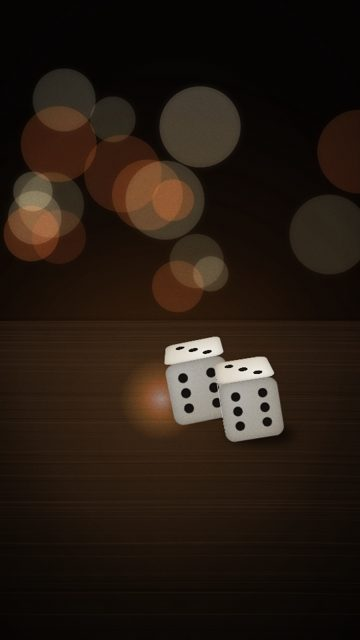

- **What you see:** Single throw landing on the drop.
- **Emotional role:** all in
- **Lyric match:** Take a chance
- **Sections:** drop1, drop2 · **Energy:** high · **Colour:** warm
- **Reacts to music:** throw at time
- **Good for:** drop
- **Generator:** `dice` `{"throws":[60],"results":[[6,6]]}`

## S084 - Snake eyes

- **What you see:** Second build's throws, snake eyes.
- **Emotional role:** lost, laughing
- **Lyric match:** rolling it twice
- **Sections:** build2 · **Energy:** mid · **Colour:** warm
- **Reacts to music:** throws at times
- **Good for:** lyric
- **Generator:** `dice` `{"throws":[153.75,155.625],"results":[[2,4],[1,1]]}`

## S085 - Dice in cold light

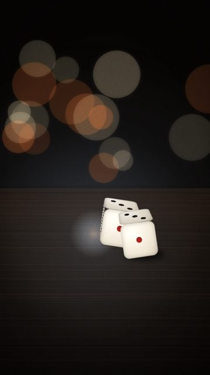

- **What you see:** Same counter under a cold light.
- **Emotional role:** sober risk
- **Lyric match:** Take a chance
- **Sections:** verse2 · **Energy:** low · **Colour:** cold
- **Reacts to music:** throws at times
- **Good for:** texture
- **Generator:** `dice` `{"tableLight":"#c9dcf2"}`
