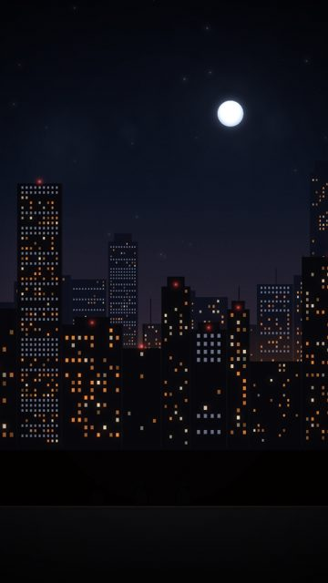
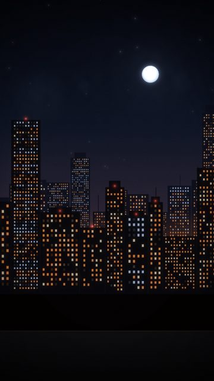

# Rooftops / height

2 shots. Preview any of them in Remotion Studio under **Shots / Shot-<ID>**.

## S024 - Rooftop, three of us

- **What you see:** City from a rooftop; three tiny silhouettes on the ledge against the glow.
- **Emotional role:** we were up there
- **Lyric match:** We rise and we fall, living forever young
- **Sections:** verse2, breakdown · **Energy:** low · **Colour:** sodium haze / navy
- **Reacts to music:** beacons blink on the kick
- **Good for:** lyric, story · **Used in:** R08, R16
- **Generator:** `skyline` `{"figures":3}`

## S026 - City waking

- **What you see:** Windows switch on across the city beat by beat.
- **Emotional role:** the night isn't over
- **Lyric match:** Shoot for the stars
- **Sections:** verse2 · **Energy:** mid · **Colour:** amber rising
- **Reacts to music:** windows on per beat after modeAt
- **Good for:** build
- **Generator:** `skyline` `{"mode":"waking","modeAt":120}`
