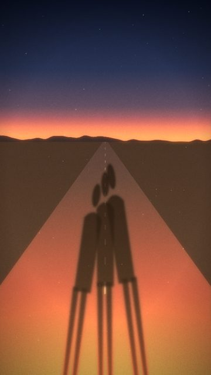
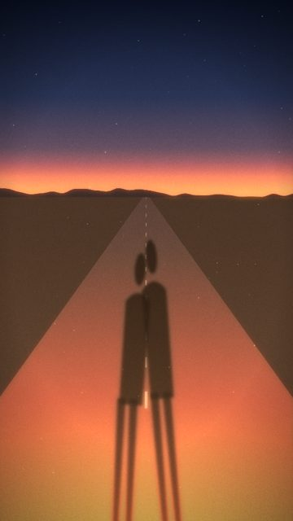
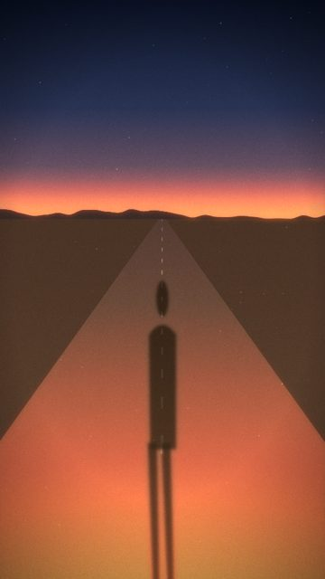

# Sun / backlight

3 shots. Preview any of them in Remotion Studio under **Shots / Shot-<ID>**.

## S046 - Backs to the sun (three)

- **What you see:** Low sun behind us; three long walking shadows run ahead down a warm road.
- **Emotional role:** together, facing forward
- **Lyric match:** Shoot for the stars with our backs to the sun
- **Sections:** verse2 · **Energy:** mid · **Colour:** warm amber / dusk
- **Reacts to music:** dust shimmer on kick
- **Good for:** lyric, story · **Used in:** R08
- **Generator:** `backlight` `{"people":3}`

## S047 - Backs to the sun (two)

- **What you see:** Two shadows side by side.
- **Emotional role:** the one who stayed
- **Lyric match:** We rise and we fall
- **Sections:** verse2 · **Energy:** low · **Colour:** warm
- **Reacts to music:** dust on kick
- **Good for:** lyric
- **Generator:** `backlight` `{"people":2}`

## S048 - Backs to the sun (alone)

- **What you see:** One shadow on the road.
- **Emotional role:** going anyway
- **Lyric match:** It's about where you're goin
- **Sections:** verse1a · **Energy:** low · **Colour:** muted warm
- **Reacts to music:** dust on kick
- **Good for:** lyric, tease
- **Generator:** `backlight` `{"people":1,"warmth":0.8}`
