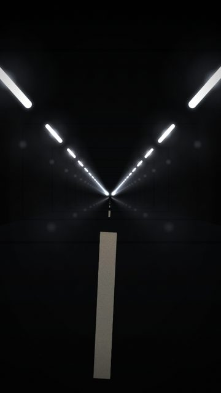
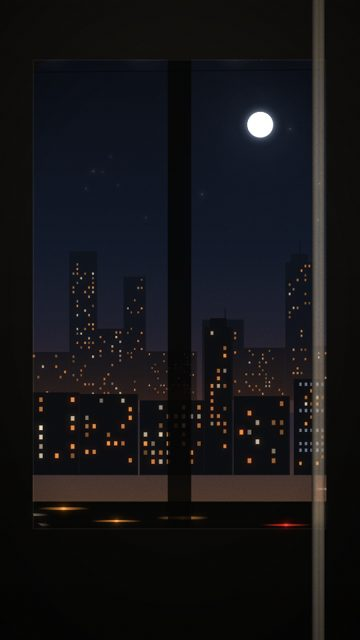
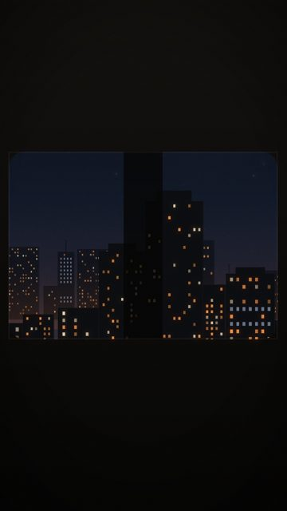
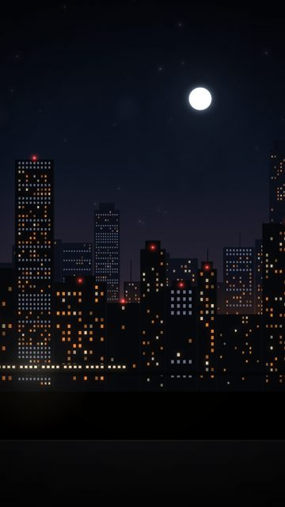

# Travel / transit

5 shots. Preview any of them in Remotion Studio under **Shots / Shot-<ID>**.

## S014 - Cold tunnel

- **What you see:** LED-lit tunnel, cooler and harder.
- **Emotional role:** pressure before release
- **Lyric match:** Take a chance
- **Sections:** build1, build2 · **Energy:** high · **Colour:** cold white / black
- **Reacts to music:** fixtures at 16ths of travel
- **Good for:** build
- **Generator:** `tunnel` `{"color":"#d6e4ff","tint":0.1}`

## S016 - Endless tunnel

- **What you see:** No exit, just the rhythm of lamps.
- **Emotional role:** momentum
- **Lyric match:** Moving to the music
- **Sections:** drop1, drop2 · **Energy:** high · **Colour:** sodium
- **Reacts to music:** fixtures at 16ths of travel
- **Good for:** drop, loop
- **Generator:** `tunnel` `{}`

## S018 - Train window, city and moon

- **What you see:** Tall carriage window; skyline, lit windows and streaked street lights slide past, masts cut through on each travel unit.
- **Emotional role:** going somewhere, together
- **Lyric match:** It's not where you been, it's about where you're goin
- **Sections:** verse1a, verse1b, verse2 · **Energy:** mid · **Colour:** sodium / navy / glass
- **Reacts to music:** masts pass once per travel unit (kick in drops)
- **Good for:** story, lyric · **Used in:** R05
- **Generator:** `train` `{}`

## S020 - Wide window strip

- **What you see:** Letterbox-like wide window band with dark carriage above and below: negative space for type.
- **Emotional role:** in transit, unsure
- **Lyric match:** Out of sight, out of mind
- **Sections:** build1, verse2 · **Energy:** mid · **Colour:** dark frame / city
- **Reacts to music:** masts on travel
- **Good for:** lyric
- **Generator:** `train` `{"frame":"wide"}`

## S028 - Train on the bridge

- **What you see:** A lit train slides across a bridge in front of the skyline.
- **Emotional role:** someone else's ride home
- **Lyric match:** It's out of sight, out of mind
- **Sections:** verse1b, breakdown · **Energy:** low · **Colour:** warm windows / navy
- **Reacts to music:** beacons on kick
- **Good for:** texture, story · **Used in:** R04
- **Generator:** `skyline` `{"trainBridge":true,"figures":0}`
