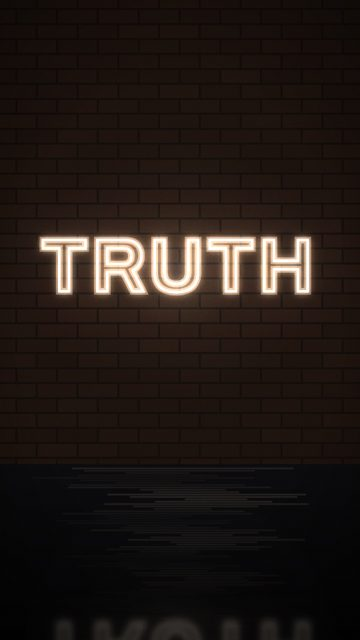
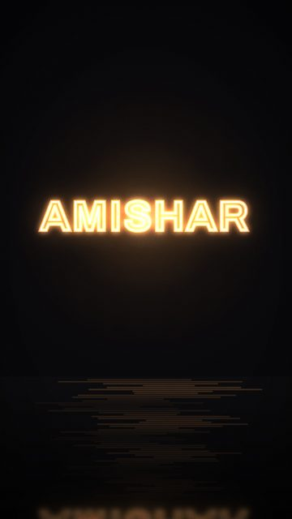
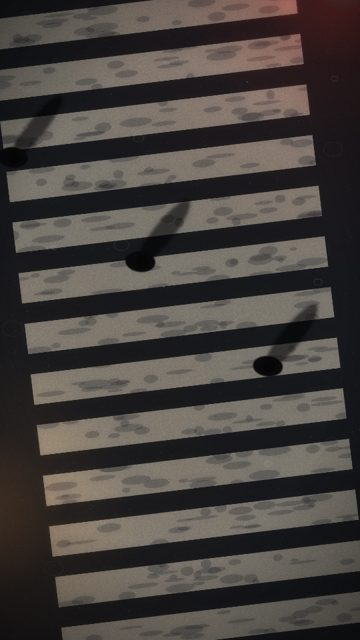
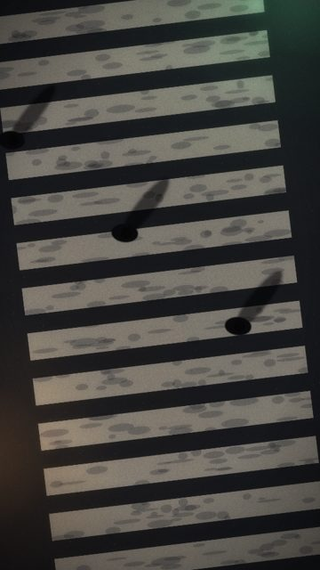
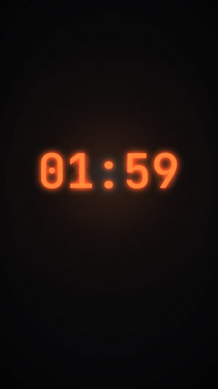
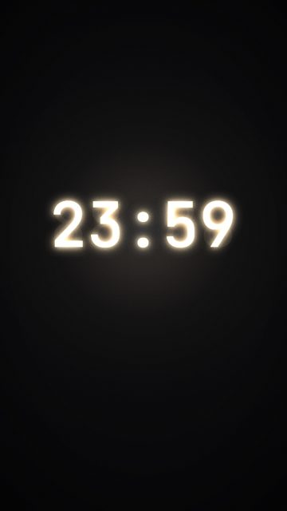
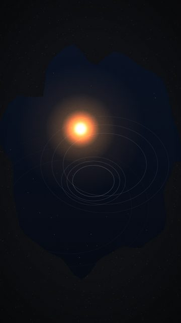

# Urban details

7 shots. Preview any of them in Remotion Studio under **Shots / Shot-<ID>**.

## S065 - Neon: TRUTH

- **What you see:** One word, buzzing like it might go out.
- **Emotional role:** honesty at 3am
- **Lyric match:** I'm taking my time, telling the truth
- **Sections:** verse1b, verse2 · **Energy:** low · **Colour:** warm white
- **Reacts to music:** heavy buzz
- **Good for:** lyric · **Used in:** R06
- **Generator:** `neon` `{"lines":["TRUTH"],"size":220,"color":"#ffe6c4","buzz":0.6}`

## S067 - Neon: AMISHAR

- **What you see:** Artist name as an amber sign.
- **Emotional role:** signature
- **Lyric match:** -
- **Sections:** drop2, outro · **Energy:** mid · **Colour:** amber
- **Reacts to music:** tube buzz
- **Good for:** endcard
- **Generator:** `neon` `{"lines":["AMISHAR"],"size":150,"color":"#ffa04a","wall":"dark"}`

## S074 - Crosswalk in rain

- **What you see:** Top-down zebra crossing, wet, red signal glow, figures crossing as shadows; rain rings.
- **Emotional role:** crossing over
- **Lyric match:** Take a chance
- **Sections:** build1, verse1b · **Energy:** mid · **Colour:** red / wet grey
- **Reacts to music:** rain rings constant
- **Good for:** story
- **Generator:** `crosswalk` `{}`

## S075 - Crosswalk, dry

- **What you see:** Dry crossing under green.
- **Emotional role:** go
- **Lyric match:** It's about where you're goin
- **Sections:** verse1a · **Energy:** low · **Colour:** green / grey
- **Reacts to music:** -
- **Good for:** story
- **Generator:** `crosswalk` `{"rain":0,"signalColor":"#6bffb0"}`

## S086 - Clock: 02:00 on the drop

- **What you see:** LED clock; 01:59 becomes 02:00 exactly on the drop.
- **Emotional role:** closing time
- **Lyric match:** grooving till the bar kicks us out
- **Sections:** build1, drop1 · **Energy:** mid · **Colour:** ember
- **Reacts to music:** minute flips at songAt
- **Good for:** reveal, drop · **Used in:** R10
- **Generator:** `clock` `{"at":"02:00","songAt":60,"label":""}`

## S088 - Clock: 23:59

- **What you see:** Midnight arrives on the first vocal.
- **Emotional role:** the start
- **Lyric match:** Moving my feet to the beat of a drum
- **Sections:** intro, verse1a · **Energy:** low · **Colour:** warm white
- **Reacts to music:** flip at songAt
- **Good for:** tease · **Used in:** R01
- **Generator:** `clock` `{"at":"00:00","songAt":15,"color":"#ffe6c4"}`

## S106 - Lamp in a puddle

- **What you see:** Sodium lamp reflection, a ring on every beat.
- **Emotional role:** time passing
- **Lyric match:** Moving my feet to the beat
- **Sections:** verse1a · **Energy:** low · **Colour:** amber
- **Reacts to music:** rings on beats
- **Good for:** texture · **Used in:** R01
- **Generator:** `puddle` `{"holds":"lamp","rings":"beat"}`
