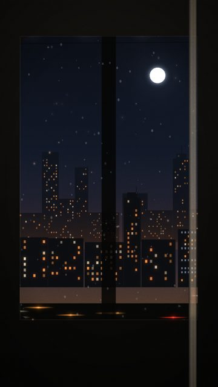
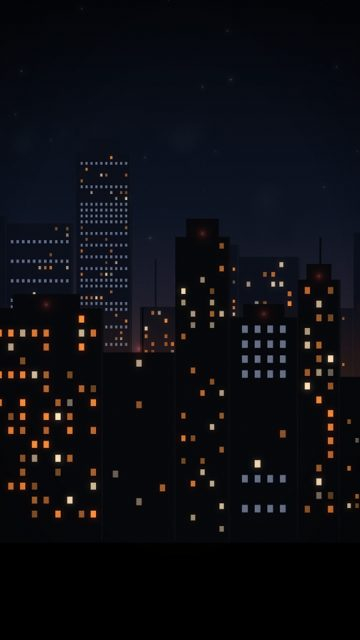
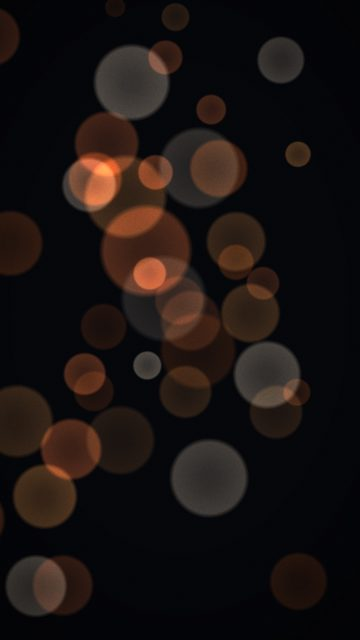
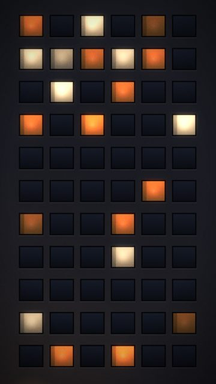
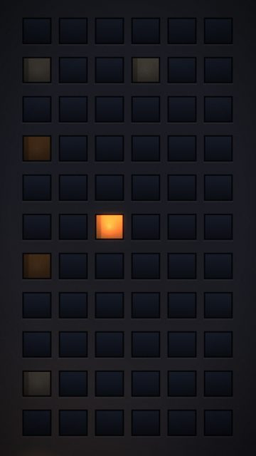
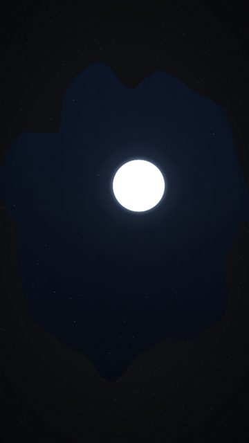

# Night windows / reflections

7 shots. Preview any of them in Remotion Studio under **Shots / Shot-<ID>**.

## S019 - Rain on the train glass

- **What you see:** Droplets and diagonal streaks on the glass over the moving city.
- **Emotional role:** looking back at the night
- **Lyric match:** If I took it alive...
- **Sections:** verse1a, breakdown · **Energy:** low · **Colour:** wet amber / blue
- **Reacts to music:** masts on travel
- **Good for:** lyric, texture
- **Generator:** `train` `{"rain":0.9}`

## S031 - Windows up close

- **What you see:** Pushed into the towers: rows of lit and dark windows.
- **Emotional role:** every window is someone's night
- **Lyric match:** Out of sight, out of mind
- **Sections:** build1, verse2 · **Energy:** mid · **Colour:** amber grid
- **Reacts to music:** beacons on kick
- **Good for:** texture
- **Generator:** `skyline` `{"zoom":1.7,"parapet":false,"moon":false}`

## S090 - Bokeh, sodium

- **What you see:** Defocused amber city lights drifting.
- **Emotional role:** memory
- **Lyric match:** If I took it alive
- **Sections:** intro, breakdown · **Energy:** low · **Colour:** amber
- **Reacts to music:** discs brighten on kick
- **Good for:** texture, lyric
- **Generator:** `bokeh` `{"palette":"sodium"}`

## S099 - Facade, quiet

- **What you see:** Apartment block face-on, a few windows lit.
- **Emotional role:** other people's nights
- **Lyric match:** Out of sight, out of mind
- **Sections:** intro, verse1a · **Energy:** low · **Colour:** amber / concrete
- **Reacts to music:** -
- **Good for:** texture
- **Generator:** `facade` `{}`

## S100 - Facade, one window

- **What you see:** Dark block; one window switches on at oneAt: someone getting ready to go out.
- **Emotional role:** the start of a night
- **Lyric match:** Moving my feet...
- **Sections:** intro · **Energy:** low · **Colour:** dark / one amber
- **Reacts to music:** on at oneAt
- **Good for:** tease, story · **Used in:** R01, R21
- **Generator:** `facade` `{"mode":"one","oneAt":7.5}`

## S104 - Moon in a puddle

- **What you see:** Looking down into a puddle holding the moon; rings on every kick.
- **Emotional role:** the sky at your feet
- **Lyric match:** say it in the moonlight
- **Sections:** verse1b, drop1 · **Energy:** mid · **Colour:** moon / asphalt
- **Reacts to music:** rings on kicks
- **Good for:** lyric, loop · **Used in:** R06
- **Generator:** `puddle` `{}`

## S108 - Still puddle

- **What you see:** Perfectly still reflection: holding breath.
- **Emotional role:** the second before
- **Lyric match:** -
- **Sections:** build1, breakdown · **Energy:** low · **Colour:** moon
- **Reacts to music:** none
- **Good for:** contrast, tease · **Used in:** R07, R15
- **Generator:** `puddle` `{"rings":"none"}`
