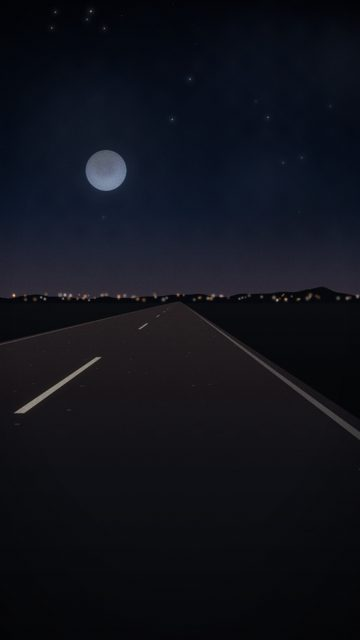
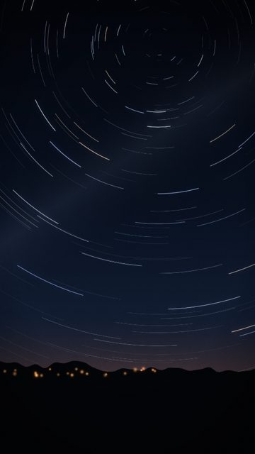
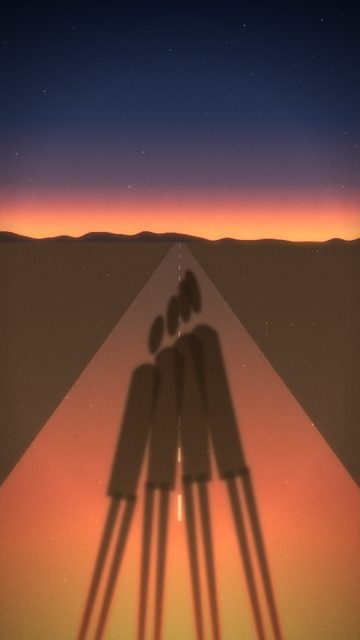
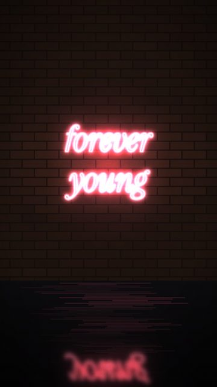
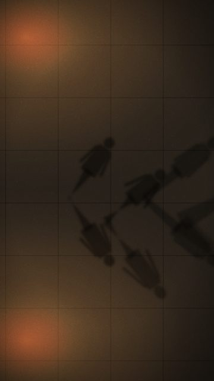

# Youth / freedom

5 shots. Preview any of them in Remotion Studio under **Shots / Shot-<ID>**.

## S007 - Open road, no lamps

- **What you see:** Unlit road under a full star field and a big moon. Only lane dashes give speed.
- **Emotional role:** nothing between you and the sky
- **Lyric match:** Shoot for the stars
- **Sections:** breakdown, verse2, intro · **Energy:** low · **Colour:** moon blue / black
- **Reacts to music:** dashes move with travel()
- **Good for:** lyric, loop · **Used in:** R07, R16
- **Generator:** `road` `{"lamps":"none","stars":1,"moonR":60,"fog":0.2}`

## S041 - Star trails

- **What you see:** Long-exposure circles; the arcs grow longer through the shot.
- **Emotional role:** the whole night in one frame
- **Lyric match:** living forever young
- **Sections:** verse2, outro · **Energy:** low · **Colour:** silver arcs
- **Reacts to music:** arc length grows with local time
- **Good for:** lyric, endcard · **Used in:** R16
- **Generator:** `stars` `{"variant":"trails"}`

## S050 - Running into it

- **What you see:** Four shadows, faster stride, the road rushing on.
- **Emotional role:** chasing something
- **Lyric match:** living forever young
- **Sections:** drop2 · **Energy:** high · **Colour:** hot amber
- **Reacts to music:** dust on kick
- **Good for:** drop · **Used in:** R16
- **Generator:** `backlight` `{"people":4,"walk":2}`

## S066 - Neon: forever young

- **What you see:** Serif rose neon.
- **Emotional role:** this age, once
- **Lyric match:** living forever young
- **Sections:** verse2 · **Energy:** mid · **Colour:** rose
- **Reacts to music:** tube buzz
- **Good for:** lyric · **Used in:** R08, R16
- **Generator:** `neon` `{"lines":["forever","young"],"font":"serif","size":170,"color":"#ff5a7a"}`

## S070 - Shadows running

- **What you see:** Four shadows at a run, lamps faster.
- **Emotional role:** late for nothing
- **Lyric match:** living forever young
- **Sections:** drop1, drop2 · **Energy:** high · **Colour:** sodium
- **Reacts to music:** lamps on travel()
- **Good for:** drop · **Used in:** R15, R16
- **Generator:** `shadows` `{"run":1,"people":4}`
